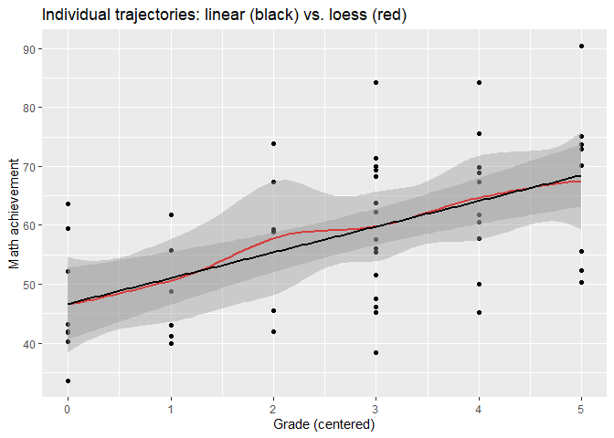
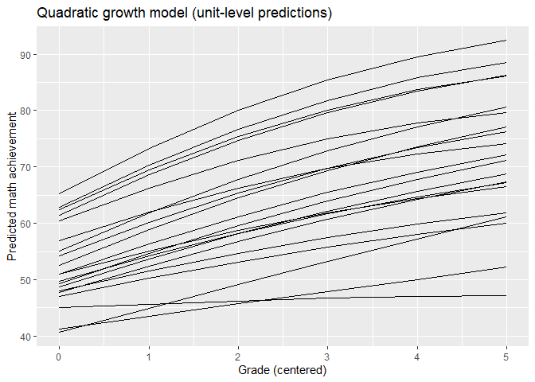
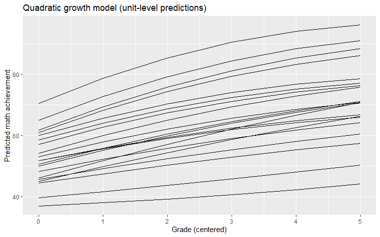
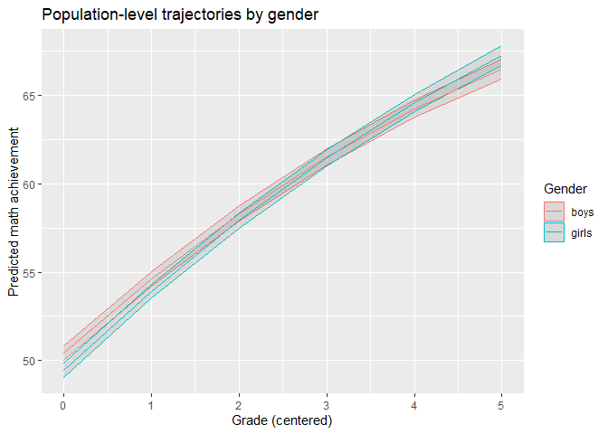
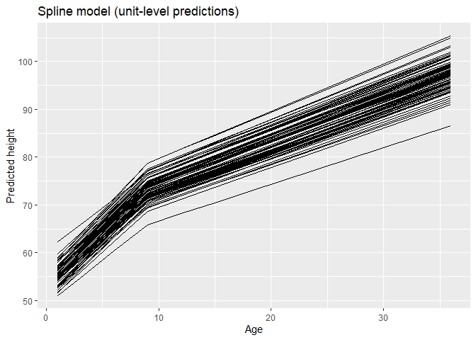
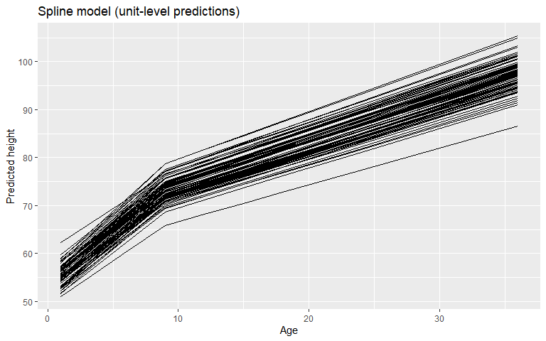
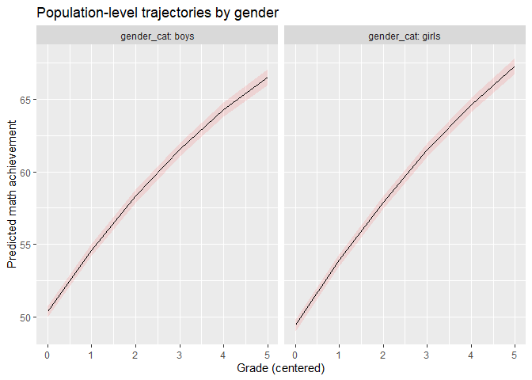

# Multilevel Regression: nonlinear longitudinal models
Mauricio Garnier-Villarreal
2026-10-21

- [<span class="toc-section-number">1</span> Introduction to Nonlinear
  Growth Models](#introduction-to-nonlinear-growth-models)
- [<span class="toc-section-number">2</span> Why Nonlinear Growth
  Models?](#why-nonlinear-growth-models)
- [<span class="toc-section-number">3</span> Polynomial
  Models](#polynomial-models)
  - [<span class="toc-section-number">3.1</span> Quadratic
    Growth](#quadratic-growth)
  - [<span class="toc-section-number">3.2</span> Cubic
    Growth](#cubic-growth)
- [<span class="toc-section-number">4</span> Packages and
  Data](#packages-and-data)
- [<span class="toc-section-number">5</span> Exploring the
  Data](#exploring-the-data)
- [<span class="toc-section-number">6</span> Fitting Polynomial Models:
  A Sequential
  Approach](#fitting-polynomial-models-a-sequential-approach)
  - [<span class="toc-section-number">6.1</span> Linear
    Baseline](#linear-baseline)
  - [<span class="toc-section-number">6.2</span> Expanded
    interpretation: the linear baseline
    (m1c)](#expanded-interpretation-the-linear-baseline-m1c)
  - [<span class="toc-section-number">6.3</span> Quadratic
    Model](#quadratic-model)
  - [<span class="toc-section-number">6.4</span> Expanded
    interpretation: the quadratic model
    (m1d2)](#expanded-interpretation-the-quadratic-model-m1d2)
  - [<span class="toc-section-number">6.5</span> Comparing the Linear
    and Quadratic Models](#comparing-the-linear-and-quadratic-models)
  - [<span class="toc-section-number">6.6</span> Expanded
    interpretation: comparing the linear and quadratic
    models](#expanded-interpretation-comparing-the-linear-and-quadratic-models)
  - [<span class="toc-section-number">6.7</span> Effect
    Sizes](#effect-sizes)
  - [<span class="toc-section-number">6.8</span> Expanded
    interpretation: effect sizes for the polynomial
    models](#expanded-interpretation-effect-sizes-for-the-polynomial-models)
  - [<span class="toc-section-number">6.9</span> Visualizing the
    Quadratic Model](#visualizing-the-quadratic-model)
- [<span class="toc-section-number">7</span> Adding Predictors to a
  Quadratic Model](#adding-predictors-to-a-quadratic-model)
  - [<span class="toc-section-number">7.1</span> Expanded
    interpretation: gender differences in growth
    (m1d5)](#expanded-interpretation-gender-differences-in-growth-m1d5)
- [<span class="toc-section-number">8</span> Spline (Piecewise)
  Models](#spline-piecewise-models)
  - [<span class="toc-section-number">8.1</span> Why
    Splines?](#why-splines)
  - [<span class="toc-section-number">8.2</span> Model
    Specification](#model-specification)
  - [<span class="toc-section-number">8.3</span> Constructing the Spline
    Predictors](#constructing-the-spline-predictors)
  - [<span class="toc-section-number">8.4</span> Fitting the Spline
    Model](#fitting-the-spline-model)
  - [<span class="toc-section-number">8.5</span> Expanded
    interpretation: the spline model
    (m4)](#expanded-interpretation-the-spline-model-m4)
  - [<span class="toc-section-number">8.6</span> Testing Whether the
    Slopes Differ](#testing-whether-the-slopes-differ)
  - [<span class="toc-section-number">8.7</span> Expanded
    interpretation: testing whether the slopes
    differ](#expanded-interpretation-testing-whether-the-slopes-differ)
  - [<span class="toc-section-number">8.8</span> Polynomial vs. Spline:
    Which Fits Better?](#polynomial-vs-spline-which-fits-better)
  - [<span class="toc-section-number">8.9</span> Expanded
    interpretation: polynomial
    vs. spline](#expanded-interpretation-polynomial-vs-spline)
  - [<span class="toc-section-number">8.10</span> Effect Sizes for
    Spline Models](#effect-sizes-for-spline-models)
  - [<span class="toc-section-number">8.11</span> Expanded
    interpretation: effect sizes for the spline
    model](#expanded-interpretation-effect-sizes-for-the-spline-model)
  - [<span class="toc-section-number">8.12</span> Visualizing the Spline
    Model](#visualizing-the-spline-model)
- [<span class="toc-section-number">9</span> Splines with
  Predictors](#splines-with-predictors)
- [<span class="toc-section-number">10</span> Effect Size Measures: A
  Recap](#effect-size-measures-a-recap)
- [<span class="toc-section-number">11</span> Visualizing
  Trajectories](#visualizing-trajectories)
- [<span class="toc-section-number">12</span> Summary and
  Recommendations](#summary-and-recommendations)
- [<span class="toc-section-number">13</span> References](#references)

## Introduction to Nonlinear Growth Models

In 16_3_MLM_longitudinal we built the multilevel growth model, where
repeated observations are nested within persons and time is a level-1
predictor. That tutorial focused on **linear** change: a single slope
that describes how the outcome rises or falls across occasions.

This tutorial extends the growth model to **nonlinear change**. Many
developmental, learning, and health processes are not linear. Children’s
height accelerates then decelerates, academic skills often grow quickly
at first and then level off, and interventions may produce an immediate
jump followed by a slower drift. A straight line cannot represent these
shapes, so we need models that can bend.

Two families of models are most common, and both are estimated within
the same multilevel framework we already know:

1.  **Polynomial models**, which add powers of time (time squared, time
    cubed) as predictors.
2.  **Spline (piecewise) models**, which join two or more straight lines
    at one or more **knots**.

As Little (2024) notes, growth curve models represent each individual’s
cross-time observations as a parsimonious model of the growth process;
nonlinear models simply replace the straight line with a more flexible
functional form while keeping the same logic of person-specific
intercepts and slopes. The key point is that everything we learned about
random effects, centering, model comparison, and effect sizes still
applies. We are only changing the shape of the level-1 trajectory.

## Why Nonlinear Growth Models?

Before adding complexity, it is worth asking whether a nonlinear model
is warranted.

- **Theoretical shape.** Does theory predict acceleration, deceleration,
  a plateau, or a discrete shift at a specific point?
- **Visual inspection.** A loess smooth overlaid on a linear fit is the
  fastest diagnostic. If the smooth bends systematically away from the
  straight line, a linear model is mis-specified.
- **Model comparison.** A nonlinear model is justified when it fits
  significantly better (likelihood ratio test) and the added parameters
  are substantively interpretable.
- **Parsimony.** A quadratic or cubic term costs parameters (especially
  when given random slopes). A spline with a theory-driven knot is often
  more interpretable and no more expensive.

A useful rule of thumb: prefer the simplest functional form that
captures the shape you have theoretical reason to expect. Polynomials
are convenient but can behave badly at the edges of the observed time
range, and high-order polynomials are notoriously hard to interpret.
Splines are more local and more interpretable when the knot is
theoretically meaningful.

## Polynomial Models

### Quadratic Growth

The most common nonlinear form is the **quadratic polynomial**. We keep
time as before and add time squared:

**Level 1 (within-person):**

$$y_{ij} = \beta_{0j} + \beta_{1j}\,time_{ij} + \beta_{2j}\,time_{ij}^2 + e_{ij}, \qquad e_{ij} \sim N(0, \sigma^2)$$

**Level 2 (between-person):**

$$\beta_{0j} = \gamma_{00} + u_{0j}$$

$$\beta_{1j} = \gamma_{10} + u_{1j}$$

$$\beta_{2j} = \gamma_{20} + u_{2j}$$

with the random effects covariance matrix

$$T = \begin{bmatrix}
\tau_{00} & & \\
\tau_{10} & \tau_{11} & \\
\tau_{20} & \tau_{21} & \tau_{22}
\end{bmatrix}$$

The fixed effects have direct interpretations:

| Parameter | Meaning |
|----|----|
| $\gamma_{00}$ | Average value of $y$ when time = 0 |
| $\gamma_{10}$ | Average **linear** component (the instantaneous slope at time = 0) |
| $\gamma_{20}$ | Average **curvature** component (the quadratic/acceleration term) |
| $\tau_{00}, \tau_{11}, \tau_{22}$ | Between-person variability in level, linear change, and curvature |
| $\tau_{10}, \tau_{20}, \tau_{21}$ | Covariances among the three person-specific parameters |

The quadratic term can be specified as a **fixed** slope, a **random**
slope, or omitted. As with the linear case, whether the curvature varies
across persons is an empirical question tested with a likelihood ratio
test.

**Sign of the curvature term.** If $\gamma_{20} < 0$ the trajectory is
concave (an inverted U, growth decelerating). If $\gamma_{20} > 0$ the
trajectory is convex (a U shape, growth accelerating). A positive
quadratic effect is shown in the lecture figure; the shape you get
depends on the sign and on where the observed time window sits relative
to the vertex of the parabola.

### Cubic Growth

If the trajectory has an inflection point (accelerating then
decelerating, or vice versa), a quadratic is not enough. Adding time
cubed gives the **cubic** model:

$$y_{ij} = \beta_{0j} + \beta_{1j}\,time_{ij} + \beta_{2j}\,time_{ij}^2 + \beta_{3j}\,time_{ij}^3 + e_{ij}$$

$$\beta_{0j} = \gamma_{00} + u_{0j}, \quad
\beta_{1j} = \gamma_{10} + u_{1j}, \quad
\beta_{2j} = \gamma_{20} + u_{2j}, \quad
\beta_{3j} = \gamma_{30} + u_{3j}$$

with a $4 \times 4$ random effects covariance matrix

$$T = \begin{bmatrix}
\tau_{00} & & & \\
\tau_{10} & \tau_{11} & & \\
\tau_{20} & \tau_{21} & \tau_{22} & \\
\tau_{30} & \tau_{31} & \tau_{32} & \tau_{33}
\end{bmatrix}$$

Cubic (and higher-order) models are easy to fit but hard to justify.
Each additional power adds a random effect variance plus covariances,
and the individual coefficients no longer map onto interpretable
features of the trajectory. Use them only when theory or the data
clearly demand it, and prefer a spline when the shape is driven by a
specific event or transition point.

## Packages and Data

We use two datasets in this tutorial.

- **`mathgrowth.csv`** — repeated math achievement (`mathach`) measured
  across grades for each student (`caseid`), with a `gender` variable.
  This is the dataset used for the polynomial examples.
- **`hght_long`** — a simulated dataset of children’s height (`hght`)
  measured by `age`, with a `group` variable. This is used for the
  spline examples because height has a natural, theory-driven knot (the
  pubertal growth spurt).

``` r
# Load required packages
library(lme4)
library(lmerTest)
library(rio)
library(parameters)
library(marginaleffects)
library(ggplot2)
library(psych)
library(performance)
library(r2mlm)
library(car)

# Read the math growth data (long format)
dat_long <- import("mathgrowth.csv", na.strings = "-999999")
head(dat_long)
```

      caseid schoolid grade mathach parentpush peerpush likemath gender race
    1      1      101     7   70.05          2        0        1      2    3
    2      1      101     8   69.23          2        2        1      2    3
    3      1      101     9   71.07          2        0        1      2    3
    4      1      101    10   78.52          2        1        1      2    3
    5      1      101    11   81.66          2        0        1      2    3
    6      1      101    12   78.77          2        0        1      2    3

``` r
dim(dat_long)
```

    [1] 35670     9

``` r
# Number of individuals
length(unique(dat_long$caseid))
```

    [1] 5945

The math data contain 35,670 rows from 5,945 students, so on average
about six measurement occasions per student (grades 7 through 12). This
is a large sample, which matters for interpretation: with tens of
thousands of observations, even very small effects will be statistically
significant, so we must weigh significance against **effect size**.

We center time at the first measured grade so that the intercept is
meaningful:

``` r
# Center grade relative to the first measured grade
dat_long$timec <- dat_long$grade - 7
```

After centering, `timec = 0` is Grade 7, `timec = 5` is Grade 12, and
the intercept of every model is interpretable as “the predicted score at
the first grade”.

## Exploring the Data

As always, we start by plotting a random subset of individuals. This is
the single most useful step before fitting any nonlinear model: it tells
us whether the average trend bends, and whether that bending is
consistent across persons.

``` r
# Sample 20 individuals for a readable plot
ids <- sample(dat_long$caseid, 20)
short <- subset(dat_long, caseid %in% ids)

ggplot(short, aes(x = timec, y = mathach)) +
  geom_point() +
  geom_smooth(method = "loess", se = TRUE, colour = "red") +
  geom_smooth(method = "lm", se = TRUE, colour = "black") +
  labs(x = "Grade (centered)",
       y = "Math achievement",
       title = "Individual trajectories: linear (black) vs. loess (red)")
```



The black line is the linear fit and the red line is a flexible loess
smooth. If the red line visibly bends away from the black line —
typically flattening at later grades — a linear model is too rigid and
we should consider a quadratic term. In these data the loess curve rises
quickly and then flattens, which is exactly the pattern a quadratic term
is designed to capture.

## Fitting Polynomial Models: A Sequential Approach

Following the same sequential strategy used in 16_MLM1 and 16_3 (Peugh,
2010), we start with the linear model, add the quadratic term, and
compare.

### Linear Baseline

``` r
m1c <- lmer(mathach ~ 1 + timec + (1 + timec | caseid),
            data = dat_long, REML = FALSE)
parameters(m1c, ci_method = "profile")
```

    # Fixed Effects

    Parameter   | Coefficient |   SE |         95% CI | t(19035) |      p
    ---------------------------------------------------------------------
    (Intercept) |       50.80 | 0.15 | [50.51, 51.10] |   337.82 | < .001
    timec       |        3.39 | 0.04 | [ 3.32,  3.46] |    96.11 | < .001

    # Random Effects

    Parameter                     | Coefficient
    -------------------------------------------
    SD (Intercept: caseid)        |        9.52
    SD (timec: caseid)            |        1.55
    Cor (Intercept~timec: caseid) |        0.32
    SD (Residual)                 |        4.53

``` r
fixef(m1c)
```

    (Intercept)       timec 
      50.803784    3.391582 

### Expanded interpretation: the linear baseline (m1c)

**Fixed effects (the average trajectory).**

| Parameter                 | Estimate | SE   | 95% CI           | t(19035) | p       |
|---------------------------|----------|------|------------------|----------|---------|
| Intercept ($\gamma_{00}$) | 50.80    | 0.15 | \[50.51, 51.10\] | 337.82   | \< .001 |
| timec ($\gamma_{10}$)     | 3.39     | 0.04 | \[3.32, 3.46\]   | 96.11    | \< .001 |

- **Intercept ($\gamma_{00} = 50.80$).** The predicted math achievement
  at Grade 7 (`timec = 0`), averaged across all students. The tiny
  standard error (0.15) shows the average starting level is estimated
  very precisely — unsurprising with nearly 6,000 students.
- **Time slope ($\gamma_{10} = 3.39$).** On average, math achievement
  increases by about **3.4 points per grade**. Over the full observed
  window (Grade 7 to Grade 12, i.e., five grade steps) the model
  predicts a total gain of $3.39 \times 5 = 16.95$ points, moving the
  average from about 50.8 to about 67.8. The effect is overwhelmingly
  significant.

**Random effects (between-student heterogeneity).**

| Parameter | Estimate (SD) | Implied variance |
|----|----|----|
| SD (Intercept: caseid) | 9.52 | 90.63 |
| SD (timec: caseid) | 1.55 | 2.40 |
| Cor (Intercept ~ timec) | 0.32 | cov $= 0.32 \times 9.52 \times 1.55 = 4.72$ |
| SD (Residual) | 4.53 | 20.52 |

- **Random intercept variance ($\tau_{00} = 9.52^2 = 90.63$).** Students
  differ enormously in where they start. About 95% of students have
  Grade 7 scores within $\pm 1.96 \times 9.52 = \pm 18.66$ of the mean,
  i.e., roughly between 32 and 69.
- **Random slope variance ($\tau_{11} = 1.55^2 = 2.40$).** Students also
  differ in how fast they grow. The implied 95% range of slopes is
  $3.39 \pm 1.96 \times 1.55 = [0.35, 6.43]$. Some students gain less
  than half a point per grade while others gain more than six — the
  “average” slope describes almost nobody exactly.
- **Intercept–slope correlation ($\rho_{01} = 0.32$).** A moderate
  positive correlation: students who start higher also tend to grow
  faster. Because the mean slope is positive, this means the
  trajectories **fan out** — initial differences widen over time.
- **Residual variance ($\sigma^2 = 4.53^2 = 20.52$).** After accounting
  for each student’s own line, individual observations still deviate by
  about 4.5 points.

**Variance partitioning at Grade 7.** Using only the intercept and
residual variances, the between-student share at Grade 7 is
$90.63 / (90.63 + 20.52) = 0.815$ — about **82% of the variance in Grade
7 achievement is between students**. This high ICC confirms that a
multilevel model is essential.

**Substantive summary.** Math achievement rises strongly and steadily on
average, but students differ a lot in both their starting level and
their rate of growth, and the two are positively related. This is the
linear benchmark against which we now test for curvature.

### Quadratic Model

``` r
m1d2 <- lmer(mathach ~ 1 + timec + I(timec^2) +
               (1 + timec + I(timec^2) | caseid),
             data = dat_long, REML = FALSE,
             control = lmerControl(optimizer = "Nelder_Mead"))
parameters(m1d2, ci_method = "profile")
```

    # Fixed Effects

    Parameter   | Coefficient |   SE | t(19031) |      p
    ----------------------------------------------------
    (Intercept) |       49.89 | 0.15 |   332.31 | < .001
    timec       |        4.61 | 0.08 |    56.95 | < .001
    timec^2     |       -0.24 | 0.01 |   -16.65 | < .001

    # Random Effects

    Parameter                          | Coefficient
    ------------------------------------------------
    SD (Intercept: caseid)             |        8.87
    SD (timec: caseid)                 |        2.26
    SD (I(timec^2): caseid)            |        0.22
    Cor (Intercept~timec: caseid)      |        0.65
    Cor (Intercept~I(timec^2): caseid) |       -0.99
    Cor (timec~I(timec^2): caseid)     |       -0.76
    SD (Residual)                      |        4.40

``` r
fixef(m1d2)
```

    (Intercept)       timec  I(timec^2) 
     49.8866808   4.6066626  -0.2434556 

Explanation of syntax:

- `I(timec^2)` creates the squared time variable. The `I()` wrapper
  tells R to compute `timec^2` *before* interpreting it as a predictor,
  rather than treating `^` as a formula operator.
- `(1 + timec + I(timec^2) | caseid)` allows the intercept, the linear
  slope, and the curvature to vary across persons. This is the full
  quadratic random-effects structure.
- `control = lmerControl(optimizer = "Nelder_Mead")` switches to a more
  robust optimizer, which is often needed for models with several
  correlated random effects. Convergence warnings with these models are
  common and are not necessarily fatal, but they should be checked.

### Expanded interpretation: the quadratic model (m1d2)

**Fixed effects.**

| Parameter                 | Estimate | SE   | t(19031) | p       |
|---------------------------|----------|------|----------|---------|
| Intercept ($\gamma_{00}$) | 49.89    | 0.15 | 332.31   | \< .001 |
| timec ($\gamma_{10}$)     | 4.61     | 0.08 | 56.95    | \< .001 |
| timec² ($\gamma_{20}$)    | -0.24    | 0.01 | -16.65   | \< .001 |

- **Intercept ($\gamma_{00} = 49.89$).** The predicted achievement at
  Grade 7. It is nearly identical to the linear model’s 50.80, which
  makes sense: adding a curvature term changes the *shape* of the
  trajectory more than its starting point.
- **Linear term ($\gamma_{10} = 4.61$).** The **instantaneous slope at
  Grade 7**. It is larger than the linear model’s 3.39 precisely because
  the curve is steepest at the beginning — a single linear slope has to
  “average over” the whole trajectory, whereas the quadratic can be
  steeper at the start and flatter later.
- **Curvature term ($\gamma_{20} = -0.24$, negative).** The trajectory
  is **concave**: growth decelerates over time. Each additional grade
  reduces the slope by $2 \times 0.243 = 0.487$ points per grade.

**Turning point and the extrapolation caveat.** The vertex of the
parabola occurs at

$$\text{timec}^* = \frac{-\gamma_{10}}{2\gamma_{20}} = \frac{4.61}{2 \times 0.2435} = 9.47$$

which corresponds to roughly Grade 16 — **far outside the observed range
(grades 7–12)**. So within the data the trajectory is still rising, just
at a decreasing rate; the “peak” is a mathematical extrapolation, not an
observed turning point. This is a first warning about polynomial
extrapolation: the fitted curve will eventually turn downward, but we
have no data to support that.

**Predicted values.** At Grade 7 the model predicts $49.89$; at Grade 12
(`timec = 5`) it predicts

$$49.89 + 4.61(5) - 0.2435(25) = 49.89 + 23.05 - 6.09 = 66.85.$$

The instantaneous slope at Grade 12 is $4.61 - 2(0.2435)(5) = 2.18$ —
about half the rate at Grade 7, which is the deceleration made concrete.

**Random effects.**

| Parameter                   | Estimate (SD) |
|-----------------------------|---------------|
| SD (Intercept: caseid)      | 8.87          |
| SD (timec: caseid)          | 2.26          |
| SD (I(timec²): caseid)      | 0.22          |
| Cor (Intercept ~ timec)     | 0.65          |
| Cor (Intercept ~ I(timec²)) | -0.99         |
| Cor (timec ~ I(timec²))     | -0.76         |
| SD (Residual)               | 4.40          |

- **Curvature varies across students** ($\tau_{22} = 0.22^2 = 0.05$).
  The implied 95% range of curvatures is
  $-0.243 \pm 1.96 \times 0.22 = [-0.674, 0.188]$. Notice this
  **includes positive values**: while the average student decelerates,
  some students are still accelerating. The shape of change is genuinely
  heterogeneous.
- **The intercept–curvature correlation of $-0.99$ is a red flag.** A
  correlation this close to the boundary ($\pm 1$) usually indicates an
  unstable, over-parameterized random structure rather than a meaningful
  finding. With only ~6 occasions per person and three correlated random
  effects, the model is straining. This is a good reason to consider
  either dropping the random curvature (keeping it fixed) or
  re-centering time — as we do in 16_3 with the aperture.
- **Residual SD barely changed** (4.53 in the linear model, 4.40 here).
  The curvature improves our description of the *average* trajectory far
  more than it reduces occasion-level scatter.

### Comparing the Linear and Quadratic Models

``` r
anova(m1c, m1d2)
```

    Data: dat_long
    Models:
    m1c: mathach ~ 1 + timec + (1 + timec | caseid)
    m1d2: mathach ~ 1 + timec + I(timec^2) + (1 + timec + I(timec^2) | caseid)
         npar    AIC    BIC logLik -2*log(L) Chisq Df Pr(>Chisq)    
    m1c     6 130778 130825 -65383    130766                        
    m1d2   10 130238 130317 -65109    130218 547.6  4  < 2.2e-16 ***
    ---
    Signif. codes:  0 '***' 0.001 '**' 0.01 '*' 0.05 '.' 0.1 ' ' 1

### Expanded interpretation: comparing the linear and quadratic models

| Comparison | ΔDeviance (χ²) | Δdf | p | AIC (smaller is better) |
|----|----|----|----|----|
| m1c → m1d2 (linear → quadratic, random curvature) | 547.6 | 4 | \< .001 | 130,778 → 130,238 |
| m1c → m_fixed_quad (linear → quadratic, fixed curvature) | 335.32 | 1 | \< .001 | 130,778 → 130,445 |

- **The curvature is real.** The likelihood ratio test rejects the
  linear model decisively ($\chi^2 = 547.6$, 4 df, $p < .001$), and the
  AIC drops by more than 500 points. The trajectory is not a straight
  line.
- **The 4 degrees of freedom** correspond to the curvature variance plus
  its three covariances (with the intercept, the slope, and the residual
  structure). In other words, we are testing whether the *whole*
  curvature random-effect block is needed.
- **Curvature is needed even as a fixed effect.** Comparing the linear
  model with a quadratic that has only a *fixed* curvature (random
  intercept and linear slope) gives $\chi^2 = 335.32$ on 1 df,
  $p < .001$ — so the average bend is highly significant on its own.
- **The random curvature adds further fit.** The difference between the
  two tests, $547.6 - 335.32 = 212.3$ on 3 df, tells us the curvature
  also *varies* across students. So the full random-curvature model is
  defensible — but recall the $-0.99$ correlation, which argues for
  treating this structure with caution.

A practical caution: when the quadratic term is only marginally
significant, or when the random curvature variance is estimated near
zero (or the correlations hit the boundary), the more parsimonious
specification is to keep the quadratic term **fixed** rather than
random:

``` r
# Quadratic fixed slope, random intercept and random linear slope
m_fixed_quad <- lmer(mathach ~ 1 + timec + I(timec^2) +
                       (1 + timec | caseid),
                     data = dat_long, REML = FALSE)
anova(m1c, m_fixed_quad)
```

    Data: dat_long
    Models:
    m1c: mathach ~ 1 + timec + (1 + timec | caseid)
    m_fixed_quad: mathach ~ 1 + timec + I(timec^2) + (1 + timec | caseid)
                 npar    AIC    BIC logLik -2*log(L)  Chisq Df Pr(>Chisq)    
    m1c             6 130778 130825 -65383    130766                         
    m_fixed_quad    7 130445 130500 -65215    130431 335.32  1  < 2.2e-16 ***
    ---
    Signif. codes:  0 '***' 0.001 '**' 0.01 '*' 0.05 '.' 0.1 ' ' 1

Comparing `m1c` (linear), `m_fixed_quad` (quadratic fixed slope), and
`m1d2` (quadratic random slope) tells you whether the curvature is
needed at all, and whether it varies across persons.

### Effect Sizes

As in the previous tutorials, we report marginal and conditional $R^2$
with the **performance** package and the full decomposition with
**r2mlm**.

``` r
r2(m1c)
```

    # R2 for Mixed Models

      Conditional R2: 0.892
         Marginal R2: 0.165

``` r
r2(m1d2)
```

    # R2 for Mixed Models

      Conditional R2: 0.898
         Marginal R2: 0.170

``` r
r2mlm(m1c, bargraph = FALSE)
```

    $Decompositions
                         total
    fixed           0.16549276
    slope variation 0.03448378
    mean variation  0.69171335
    sigma2          0.10831011

    $R2s
             total
    f   0.16549276
    v   0.03448378
    m   0.69171335
    fv  0.19997654
    fvm 0.89168989

For `r2mlm` we have to re-run the model with variables in the data
instead of calculation in the formula. I still keep the first setup as
it is better for plots

``` r
dat_long$timec2 <- dat_long$timec^2
m1d22 <- lmer(mathach ~ 1 + timec + timec2 +
               (1 + timec + timec2 | caseid),
             data = dat_long, REML = FALSE,
             control = lmerControl(optimizer = "Nelder_Mead"))
#parameters(m1d22, ci_method = "profile") ## the same as before

r2mlm(m1d22, bargraph = FALSE)
```

    $Decompositions
                        total
    fixed           0.1704930
    slope variation 0.0384466
    mean variation  0.6890791
    sigma2          0.1019813

    $R2s
            total
    f   0.1704930
    v   0.0384466
    m   0.6890791
    fv  0.2089396
    fvm 0.8980187

### Expanded interpretation: effect sizes for the polynomial models

| Model            | Marginal $R^2$ | Conditional $R^2$ |
|------------------|----------------|-------------------|
| m1c (linear)     | 0.165          | 0.892             |
| m1d2 (quadratic) | 0.170          | 0.898             |

- **Marginal $R^2$** (fixed effects only): time alone explains about
  **16.5%** of the total variance in math achievement. **Conditional
  $R^2$** (fixed + random): the full model explains about **89.2%**. The
  large gap (0.73) is the share attributable to between-student
  differences in level and growth — the random effects, not the
  predictors, are doing most of the explanatory work.
- **The quadratic adds almost nothing to $R^2$.** Going from linear to
  quadratic raises the marginal $R^2$ from 0.165 to 0.170 — a gain of
  **0.5 percentage points** — and the conditional $R^2$ from 0.892 to
  0.898. This is the key lesson of the whole section: with
  $n = 35{,}670$ observations, the curvature is **statistically
  significant but substantively tiny**. A significant likelihood ratio
  test does not imply a meaningful improvement in explained variance.

The Rights and Sterba (2019) decomposition makes the source of the
variance explicit:

| Source                       | m1c (linear) | m1d2 (quadratic) |
|------------------------------|--------------|------------------|
| `fixed` (average trajectory) | 0.165        | 0.170            |
| `slope variation` ($v$)      | 0.034        | 0.038            |
| `mean variation` ($m$)       | 0.692        | 0.689            |
| `sigma2` (residual)          | 0.108        | 0.102            |
| `fvm` (conditional $R^2$)    | 0.892        | 0.898            |

- The dominant component is `mean variation` ($m \approx 0.69$): nearly
  **70% of the total variance is between-student differences in level**.
  This is the signature of an achievement measure — where a student
  starts matters far more than how they change.
- `slope variation` ($v$) rises only slightly from 0.034 to 0.038 when
  the random curvature is added. That is the extra variance attributable
  to individual differences in *shape*.
- The residual (`sigma2`) is remarkably small (about 0.10–0.11), because
  each student’s own random line already absorbs most
  occasion-to-occasion variation.

**Takeaway.** Report both $R^2$ measures, and pay attention to `v`: it
is the only component that speaks to heterogeneity in the *shape* of the
trajectory, and here it is small.

### Visualizing the Quadratic Model

Unit-level predictions show each person’s fitted curve:

``` r
nd <- datagrid(model = m1d2,
               caseid = sample(m1d2@frame$caseid, 20),
               timec = 0:5)

pred1 <- predictions(m1d2, newdata = nd)

ggplot(pred1, aes(timec, estimate, group = caseid)) +
  geom_line() +
  labs(y = "Predicted math achievement",
       x = "Grade (centered)",
       title = "Quadratic growth model (unit-level predictions)")
```



Population-level predictions average over the random effects and show
the average curvature with its confidence band:

``` r
nd <- datagrid(model = m1d2, caseid = NA, timec = 0:5)

pred3 <- predictions(m1d2, newdata = nd, re.form = NA)

ggplot(pred3, aes(x = timec, y = estimate,
                  ymin = conf.low, ymax = conf.high)) +
  geom_ribbon(alpha = .1) +
  geom_line() +
  labs(y = "Predicted math achievement",
       x = "Grade (centered)",
       title = "Population-level trajectory (quadratic)")
```



In the unit-level plot the fitted curves fan out and some are visibly
flatter than others, which is the visual counterpart of the slope and
curvature variances. In the population-level plot the average curve
bends downward (decelerates) and the confidence band is very narrow —
again because the sample is large.

## Adding Predictors to a Quadratic Model

Once the shape is settled, predictors can be added exactly as in the
linear growth model: a level-2 predictor of the intercept, the linear
slope, and/or the curvature. The general model is:

$$\begin{array}{l}
y_{ij} = \beta_{0j} + \beta_{1j}\,time_{ij} + \beta_{2j}\,time_{ij}^2 + e_{ij} \\
\beta_{0j} = \gamma_{00} + \gamma_{01}Group_{j} + u_{0j} \\
\beta_{1j} = \gamma_{10} + \gamma_{11}Group_{j} + u_{1j} \\
\beta_{2j} = \gamma_{20} + \gamma_{21}Group_{j} + u_{2j}
\end{array}$$

The fixed effects are interpreted as:

| Parameter     | Meaning                                                |
|---------------|--------------------------------------------------------|
| $\gamma_{00}$ | Average value of $y$ at time 0 for the reference group |
| $\gamma_{10}$ | Average linear slope at time 0 for the reference group |
| $\gamma_{20}$ | Average curvature at time 0 for the reference group    |
| $\gamma_{01}$ | Difference in the intercept between groups             |
| $\gamma_{11}$ | Difference in the linear slope between groups          |
| $\gamma_{21}$ | Difference in the curvature between groups             |

In `lmer()` syntax, each product term is a **cross-level interaction**
between time and the group variable:

``` r
# Recode gender as a labeled factor
dat_long$gender_cat <- factor(dat_long$gender,
                              levels = c(1, 2),
                              labels = c("boys", "girls"))

m1d5 <- lmer(mathach ~ 1 + timec * gender_cat + I(timec^2) * gender_cat +
               (1 + timec + I(timec^2) | caseid),
             data = dat_long, REML = FALSE,
             control = lmerControl(optimizer = "Nelder_Mead"))
parameters(m1d5, ci_method = "profile")
```

    # Fixed Effects

    Parameter                    | Coefficient |   SE | t(19028) |      p
    ---------------------------------------------------------------------
    (Intercept)                  |       50.40 | 0.21 |   243.73 | < .001
    timec                        |        4.45 | 0.11 |    38.74 | < .001
    gender cat [girls]           |       -0.95 | 0.29 |    -3.29 | < .001
    timec^2                      |       -0.25 | 0.02 |   -11.70 | < .001
    timec × gender cat [girls]   |        0.24 | 0.16 |     1.47 | 0.142 
    gender cat [girls] × timec^2 |        0.02 | 0.03 |     0.69 | 0.492 

    # Random Effects

    Parameter                          | Coefficient
    ------------------------------------------------
    SD (Intercept: caseid)             |        8.44
    SD (timec: caseid)                 |        2.34
    SD (I(timec^2): caseid)            |        0.29
    Cor (Intercept~timec: caseid)      |        0.75
    Cor (Intercept~I(timec^2): caseid) |       -0.87
    Cor (timec~I(timec^2): caseid)     |       -0.77
    SD (Residual)                      |        4.43

### Expanded interpretation: gender differences in growth (m1d5)

Note that `gender_cat` is created with `levels = c(1, 2)` and labels
`c("boys", "girls")`, so **boys are the reference group**. Every “main
effect” below is therefore the value for boys, and the `[girls]` rows
are the differences for girls.

**Fixed effects.**

| Parameter                        | Estimate | SE   | t(19028) | p       |
|----------------------------------|----------|------|----------|---------|
| Intercept ($\gamma_{00}$)        | 50.40    | 0.21 | 243.73   | \< .001 |
| timec ($\gamma_{10}$)            | 4.45     | 0.11 | 38.74    | \< .001 |
| gender \[girls\] ($\gamma_{01}$) | -0.95    | 0.29 | -3.29    | \< .001 |
| timec² ($\gamma_{20}$)           | -0.25    | 0.02 | -11.70   | \< .001 |
| timec × girls ($\gamma_{11}$)    | 0.24     | 0.16 | 1.47     | 0.142   |
| girls × timec² ($\gamma_{21}$)   | 0.02     | 0.03 | 0.69     | 0.492   |

- **Boys’ trajectory** (the reference): intercept $50.40$, linear slope
  at Grade 7 $4.45$, curvature $-0.25$.
- **Girls’ trajectory** (reference + difference): intercept
  $50.40 - 0.95 = 49.45$, linear slope $4.45 + 0.24 = 4.69$, curvature
  $-0.25 + 0.02 = -0.23$.
- **The groups differ at the start, but not in shape.** The intercept
  difference of $-0.95$ is significant ($p < .001$): girls begin about
  **one point lower** at Grade 7. But the difference in the linear slope
  ($0.24$, $p = 0.142$) and the difference in curvature ($0.02$,
  $p = 0.492$) are both **not significant**.
- **How to report it.** The honest conclusion is: “Girls start slightly
  lower than boys, but there is no evidence that the two groups differ
  in their rate of change or in the curvature of their growth.”
  Reporting the non-significant interaction terms as “no difference in
  growth” is correct — but be careful not to over-interpret the small
  non-significant slope difference, since with this sample size a
  genuine difference of 0.24 points per grade would very likely have
  been detected.

**Random effects.**

| Parameter                   | Estimate (SD) |
|-----------------------------|---------------|
| SD (Intercept: caseid)      | 8.44          |
| SD (timec: caseid)          | 2.34          |
| SD (I(timec²): caseid)      | 0.29          |
| Cor (Intercept ~ timec)     | 0.75          |
| Cor (Intercept ~ I(timec²)) | -0.87         |
| Cor (timec ~ I(timec²))     | -0.77         |
| SD (Residual)               | 4.43          |

The random effects are similar to the model without gender, and the
extreme intercept–curvature correlations ($-0.87$, $-0.77$) again point
to a fragile random structure. Adding a level-2 predictor of the
intercept and slope did not fix that.

Because these are interactions, they are probed and plotted with the
same tools we used in 16_2_MLM_interactions. For a categorical moderator
the interpretation is simpler than for a continuous one: we have one
trajectory per group, and we can plot them directly:

``` r
nd <- datagrid(model = m1d5, caseid = NA, timec = 0:5,
               gender_cat = levels(m1d5@frame$gender_cat))

pred4 <- predictions(m1d5, newdata = nd, re.form = NA)

ggplot(pred4, aes(x = timec, colour = gender_cat,
                  y = estimate,
                  ymin = conf.low, ymax = conf.high)) +
  geom_ribbon(alpha = .1) +
  geom_line() +
  labs(y = "Predicted math achievement",
       x = "Grade (centered)",
       title = "Population-level trajectories by gender",
       colour = "Gender")
```



The two curves will be nearly parallel but vertically offset, which is
exactly what “different intercept, same shape” looks like.

## Spline (Piecewise) Models

### Why Splines?

Polynomials model curvature globally: a single quadratic imposes the
same bend everywhere. But many processes change in a **specific, local**
way. Growth in height accelerates sharply around puberty; an
intervention produces a jump at a known time point; a policy change
takes effect on a known date.

A **spline** (or piecewise) model fits separate straight lines on either
side of a **knot** $K$. The lines are joined at the knot, so the
trajectory is continuous but the slope can change abruptly. This is far
more interpretable than a cubic: instead of an abstract curvature
parameter, we get “the slope before the knot” and “the slope after the
knot.”

### Model Specification

With a single knot at $K$:

$$y_{ij} = \beta_{0j} + \beta_{1j}\,time_{ij}^{<K} + \beta_{2j}\,time_{ij}^{>K} + e_{ij}$$

$$\beta_{0j} = \gamma_{00} + u_{0j}, \quad
\beta_{1j} = \gamma_{10} + u_{1j}, \quad
\beta_{2j} = \gamma_{20} + u_{2j}$$

where the two spline predictors are constructed so that exactly one of
them is non-zero at any given time:

- $time^{<K} = \min(0,\; time - K)$ — the linear piece **before** the
  knot
- $time^{>K} = \max(0,\; time - K)$ — the linear piece **after** the
  knot

The fixed effects are interpreted as:

| Parameter | Meaning |
|----|----|
| $\gamma_{00}$ | Average value of $y$ at the knot (when the knot is the time origin) |
| $\gamma_{10}$ | Average slope **before** the knot |
| $\gamma_{20}$ | Average slope **after** the knot |

### Constructing the Spline Predictors

Import a new data set, based on Grimm, K. J., Ram, N., & Estabrook, R.
(2016). *Growth modeling: Structural equation and multilevel modeling
approaches*. Guilford Publications, p. 250.

``` r
hght_long <- import("bgs_height_long.csv")
summary(hght_long)
```

           id          age             hght       
     Min.   : 1   Min.   : 1.00   Min.   : 49.50  
     1st Qu.:21   1st Qu.: 6.00   1st Qu.: 65.00  
     Median :42   Median :12.00   Median : 74.20  
     Mean   :42   Mean   :13.78   Mean   : 74.34  
     3rd Qu.:63   3rd Qu.:18.00   3rd Qu.: 83.20  
     Max.   :83   Max.   :36.00   Max.   :106.00  
                                  NAs    :166     

``` r
head(hght_long)
```

      id age hght
    1  1   1 53.5
    2  1   3 60.4
    3  1   6 67.2
    4  1   9 70.9
    5  1  12 76.2
    6  1  15 81.1

The height data contain 83 children measured at up to nine ages (1, 3,
6, 9, 12, 15, 18, 24, and 36 years), with 166 missing heights. Because
these are natural developmental milestones, a spline with a knot at the
onset of puberty is theoretically motivated rather than statistically
chosen.

For the height data, theory suggests a knot at age 9 (the onset of the
pubertal growth spurt). We build the two predictors with `pmin()` and
`pmax()`:

``` r
# Inspect the spline basis at each observed age
ages <- unique(hght_long$age)
cbind(ages,
      before = pmin(0, ages - 9),
      after  = pmax(0, ages - 9))
```

          ages before after
     [1,]    1     -8     0
     [2,]    3     -6     0
     [3,]    6     -3     0
     [4,]    9      0     0
     [5,]   12      0     3
     [6,]   15      0     6
     [7,]   18      0     9
     [8,]   24      0    15
     [9,]   36      0    27

This shows the mechanics: `pmin(0, age - 9)` is zero at ages 9 and above
and negative below, while `pmax(0, age - 9)` is zero below age 9 and
positive above. Together they define the two line segments. At the knot
(age 9) both are zero, which is why the model intercept is the average
height **at age 9**.

### Fitting the Spline Model

``` r
m4 <- lmer(hght ~ 1 + pmin(0, age - 9) + pmax(0, age - 9) +
             (1 + pmin(0, age - 9) + pmax(0, age - 9) | id),
           data = hght_long, REML = FALSE,
           control = lmerControl(optimizer = "Nelder_Mead"))
parameters(m4, ci_method = "profile")
```

    # Fixed Effects

    Parameter        | Coefficient |       SE |         95% CI | t(571) |      p
    ----------------------------------------------------------------------------
    (Intercept)      |       73.35 |     0.29 | [72.77, 73.94] | 249.67 | < .001
    pmin(0, age - 9) |        2.23 |     0.03 | [ 2.16,  2.29] |  67.06 | < .001
    pmax(0, age - 9) |        0.89 | 9.47e-03 | [ 0.87,  0.91] |  93.71 | < .001

    # Random Effects

    Parameter                                   | Coefficient
    ---------------------------------------------------------
    SD (Intercept: id)                          |        2.47
    SD (pmin(0, age - 9): id)                   |        0.21
    SD (pmax(0, age - 9): id)                   |        0.05
    Cor (Intercept~pmin(0, age - 9): id)        |        0.45
    Cor (Intercept~pmax(0, age - 9): id)        |        0.73
    Cor (pmin(0, age - 9)~pmax(0, age - 9): id) |        0.86
    SD (Residual)                               |        1.35

Explanation of syntax:

- `pmin(0, age - 9)` and `pmax(0, age - 9)` are the two spline pieces
  described above. They are computed inline; you could equally create
  them as new columns with clearer names (e.g., `age_before9`,
  `age_after9`), which is often easier to read in the model output.
- `(1 + pmin(...) + pmax(...) | id)` gives random intercepts and random
  slopes for both pieces, so each person can have their own pre-knot
  slope, post-knot slope, and intercept.
- The optimizer is switched to Nelder-Mead because the two spline pieces
  are highly correlated for individuals with few observations before or
  after the knot.

### Expanded interpretation: the spline model (m4)

**Fixed effects.**

| Parameter | Estimate | SE | 95% CI | t(571) | p |
|----|----|----|----|----|----|
| Intercept ($\gamma_{00}$) | 73.35 | 0.29 | \[72.77, 73.94\] | 249.67 | \< .001 |
| pmin (before knot) ($\gamma_{10}$) | 2.23 | 0.03 | \[2.16, 2.29\] | 67.06 | \< .001 |
| pmax (after knot) ($\gamma_{20}$) | 0.89 | 0.01 | \[0.87, 0.91\] | 93.71 | \< .001 |

- **Intercept ($\gamma_{00} = 73.35$ cm).** The average height **at age
  9** — the point where the two lines meet. Because both spline terms
  are zero at the knot, this value is directly interpretable.
- **Pre-knot slope ($\gamma_{10} = 2.23$ cm/year).** Before age 9,
  children grow on average about **2.2 cm per year**.
- **Post-knot slope ($\gamma_{20} = 0.89$ cm/year).** After age 9, the
  average slope is about **0.9 cm per year** — roughly **40%** of the
  pre-knot rate ($0.89 / 2.23 = 0.40$).
- **An important interpretive caveat.** The post-knot piece is a single
  straight line spanning ages 9 to 36. That range mixes the pubertal
  spurt (roughly 9–15) with the plateau after growth stops (roughly
  18–36). Averaging over both **dilutes** the spurt, so the post-knot
  slope of 0.89 *understates* how fast children actually grow during
  puberty. If the spurt itself were the focus, a second knot (or a
  quadratic piece) would be needed. This is a general lesson: a spline
  is only as good as the knot placement, and a single post-knot line can
  hide a second change point.

**Random effects.**

| Parameter              | Estimate (SD) |
|------------------------|---------------|
| SD (Intercept: id)     | 2.47          |
| SD (pmin: id)          | 0.21          |
| SD (pmax: id)          | 0.05          |
| Cor (Intercept ~ pmin) | 0.45          |
| Cor (Intercept ~ pmax) | 0.73          |
| Cor (pmin ~ pmax)      | 0.86          |
| SD (Residual)          | 1.35          |

- **Children differ in height at age 9** ($\tau_{00} = 2.47^2 = 6.10$):
  about 95% are within $\pm 1.96 \times 2.47 = \pm 4.84$ cm of the mean,
  i.e., roughly 68.5 to 78.2 cm.
- **Pre-knot growth rate varies across children** (SD $= 0.21$): the 95%
  range of pre-knot slopes is $2.23 \pm 1.96 \times 0.21 = [1.82, 2.64]$
  cm/year.
- **Post-knot growth rate barely varies** (SD $= 0.05$): the 95% range
  is $0.89 \pm 1.96 \times 0.05 = [0.79, 0.99]$. So after age 9,
  essentially all children grow at about the same rate; the
  between-child differences are concentrated in the pre-knot period and
  in overall size.
- **The correlations are all positive.** Taller-at-9 children grew
  faster before 9 ($0.45$) and faster after 9 ($0.73$), and children who
  grew fast before 9 also grew fast after 9 ($0.86$).
- **Residual SD $= 1.35$ cm** — small measurement-plus-occasion noise.

**Substantive summary.** The spline gives a simple, interpretable
description: children grow quickly (about 2.2 cm/year) before age 9 and
then more slowly (about 0.9 cm/year). Children differ mainly in how tall
they are at 9 and in their pre-knot growth rate; post-knot growth is
remarkably uniform.

### Testing Whether the Slopes Differ

The central question in a spline model is whether the slope actually
changes at the knot. We test this directly with a linear hypothesis on
the fitted model:

``` r
linearHypothesis(m4, "pmin(0, age - 9) = pmax(0, age - 9)", test = "Chisq")
```


    Linear hypothesis test:
    pmin(0, age - 9) = pmax(0, age - 9)

    Model 1: restricted model
    Model 2: hght ~ 1 + pmin(0, age - 9) + pmax(0, age - 9) + (1 + pmin(0, 
        age - 9) + pmax(0, age - 9) | id)

      Df  Chisq Pr(>Chisq)    
    1                         
    2  1 1591.5  < 2.2e-16 ***
    ---
    Signif. codes:  0 '***' 0.001 '**' 0.01 '*' 0.05 '.' 0.1 ' ' 1

### Expanded interpretation: testing whether the slopes differ

- The null hypothesis is that the pre-knot and post-knot slopes are
  equal. The test rejects that null decisively: $\chi^2 = 1591.5$ on 1
  degree of freedom, $p < .001$.
- **The change point is real.** The slope before age 9 ($2.23$) is
  significantly different from the slope after age 9 ($0.89$). The knot
  is doing genuine work, and a single straight line would misrepresent
  the process.

If the null hypothesis (equal slopes before and after the knot) is
rejected, the change point is real. If it is not rejected, the spline is
not buying you anything over a single linear slope, and you should
prefer the simpler model. Note that `linearHypothesis()` comes from the
**car** package.

An equivalent test is to compare the spline model against a linear model
with `anova()`:

``` r
m_lin <- lmer(hght ~ 1 + age + (1 + age | id),
              data = hght_long, REML = FALSE,
              control = lmerControl(optimizer = "Nelder_Mead"))
anova(m_lin, m4)
```

    Data: hght_long
    Models:
    m_lin: hght ~ 1 + age + (1 + age | id)
    m4: hght ~ 1 + pmin(0, age - 9) + pmax(0, age - 9) + (1 + pmin(0, age - 9) + pmax(0, age - 9) | id)
          npar    AIC    BIC  logLik -2*log(L)  Chisq Df Pr(>Chisq)    
    m_lin    6 3205.3 3231.5 -1596.6    3193.3                         
    m4      10 2359.2 2402.8 -1169.6    2339.2 854.09  4  < 2.2e-16 ***
    ---
    Signif. codes:  0 '***' 0.001 '**' 0.01 '*' 0.05 '.' 0.1 ' ' 1

- The likelihood ratio test confirms this: $\chi^2 = 854.09$ on 4 df,
  $p < .001$, and the AIC falls from 3205.3 to 2359.2 — a drop of nearly
  **850 points**.
- So the spline is not just statistically better; it is dramatically
  better. A single linear slope across ages 1–36 is a very poor
  description of human growth, as anyone who has seen a growth chart
  would expect.

### Polynomial vs. Spline: Which Fits Better?

If you have both a quadratic and a spline model for the same data,
compare them directly. The quadratic imposes a smooth bend; the spline
imposes a sharp change at the knot. Whichever fits better, after
accounting for the number of parameters, is the better description of
the process.

``` r
# Compare linear, quadratic, and spline fits
hght_long$age_c <- hght_long$age - 1

m1 <- lmer(hght ~ 1 + age_c + (1 + age_c | id),
           data = hght_long, REML = FALSE,
           control = lmerControl(optimizer = "Nelder_Mead"))

m2 <- lmer(hght ~ 1 + age_c + I(age_c^2) +
             (1 + age_c + I(age_c^2) | id),
           data = hght_long, REML = FALSE,
           control = lmerControl(optimizer = "Nelder_Mead"))

m3 <- lmer(hght ~ 1 + age_c + I(age_c^2) + (1 + age_c | id),
           data = hght_long, REML = FALSE,
           control = lmerControl(optimizer = "Nelder_Mead"))

anova(m1, m2, m3)
```

    Data: hght_long
    Models:
    m1: hght ~ 1 + age_c + (1 + age_c | id)
    m3: hght ~ 1 + age_c + I(age_c^2) + (1 + age_c | id)
    m2: hght ~ 1 + age_c + I(age_c^2) + (1 + age_c + I(age_c^2) | id)
       npar    AIC    BIC  logLik -2*log(L)   Chisq Df Pr(>Chisq)    
    m1    6 3205.3 3231.5 -1596.6    3193.3                          
    m3    7 2515.3 2545.8 -1250.6    2501.3 692.002  1  < 2.2e-16 ***
    m2   10 2505.7 2549.4 -1242.9    2485.7  15.547  3   0.001404 ** 
    ---
    Signif. codes:  0 '***' 0.001 '**' 0.01 '*' 0.05 '.' 0.1 ' ' 1

Here `m1` is the linear model, `m2` is the quadratic with a random
curvature, and `m3` is the quadratic with a fixed curvature (random
intercept and linear slope only). The comparison tells you both whether
curvature is needed and whether it varies across children.

### Expanded interpretation: polynomial vs. spline

| Comparison | ΔDeviance (χ²) | Δdf | p | AIC |
|----|----|----|----|----|
| m1 → m3 (linear → quadratic, fixed curvature) | 692.00 | 1 | \< .001 | 3205.3 → 2515.3 |
| m3 → m2 (fixed → random curvature) | 15.55 | 3 | .0014 | 2515.3 → 2505.7 |
| m4 (spline) vs m2 (best quadratic) | — | — | — | **2359.2 vs 2505.7** |

- **Curvature is needed**: the quadratic clearly beats the linear model
  ($\chi^2 = 692$ on 1 df).
- **The curvature varies across children**: allowing the random
  curvature adds significant fit ($\chi^2 = 15.55$ on 3 df,
  $p = .0014$), though the AIC improvement is modest (2515.3 → 2505.7).
- **The spline wins.** The best quadratic (`m2`) has 10 parameters and
  an AIC of 2505.7; the spline (`m4`) also has 10 parameters and an AIC
  of 2359.2. With the **same number of parameters**, the spline improves
  the AIC by about **146 points**. Because the spline’s knot is
  theoretically grounded (puberty) and it fits better, it is the model
  of choice here. This is a clean illustration of the general rule: when
  you have a theory-driven change point, a spline is usually more
  efficient than a global polynomial.

### Effect Sizes for Spline Models

``` r
r2(m4)
```

    # R2 for Mixed Models

      Conditional R2: 0.989
         Marginal R2: 0.945

For `r2mlm` we have to re-run the model with variables in the data
instead of calculation in the formula. I still keep the first setup as
it is better for plots

``` r
hght_long$pmin9 <-  pmin(0, hght_long$age - 9)
hght_long$pmax9 <-  pmax(0, hght_long$age - 9)

m42 <- lmer(hght ~ 1 + pmin9 + pmax9 +
             (1 + pmin9 + pmax9 | id),
           data = hght_long, REML = FALSE,
           control = lmerControl(optimizer = "Nelder_Mead"))
# parameters(m42, ci_method = "profile") # the same as before

r2mlm(m42, bargraph = FALSE)
```

    $Decompositions
                          total
    fixed           0.945129333
    slope variation 0.004690853
    mean variation  0.038960485
    sigma2          0.011219330

    $R2s
              total
    f   0.945129333
    v   0.004690853
    m   0.038960485
    fv  0.949820185
    fvm 0.988780670

### Expanded interpretation: effect sizes for the spline model

| Measure                   | Value |
|---------------------------|-------|
| Marginal $R^2$            | 0.945 |
| Conditional $R^2$         | 0.989 |
| `fixed`                   | 0.945 |
| `slope variation` ($v$)   | 0.005 |
| `mean variation` ($m$)    | 0.039 |
| `sigma2` (residual)       | 0.011 |
| `fvm` (conditional $R^2$) | 0.989 |

- **The fixed effects explain almost everything.** A marginal $R^2$ of
  **0.945** means the two spline slopes plus the intercept account for
  94.5% of the variance in height. Adding the random effects raises this
  only to 98.9%.
- **The structure is the opposite of the math example.** For math
  achievement, the dominant component was `mean variation` ($m = 0.69$).
  Here it is `fixed` ($0.945$). Why? Because height is almost entirely
  determined by age, so the *average* trajectory explains the data; and
  because children’s growth rates are fairly similar (recall the small
  slope SDs), there is little left for the random effects to explain.
- **`v` is small (0.005).** Unlike the math example, children do not
  differ much in the *shape* of their growth — the average spline
  describes nearly all children well.
- **Residual is tiny (0.011).** Only about 1% of the variance is left
  unexplained at the occasion level.

**Practical note on `r2mlm` with splines.** As with the quadratic, we
had to create `pmin9` and `pmax9` as explicit columns before calling
`r2mlm()`. The function is sensitive to inline-transformed terms like
`pmin(0, age - 9)` inside the formula; creating the columns first and
refitting resolves it. The refit model (`m42`) is identical to `m4`, so
the effect sizes are unchanged.

### Visualizing the Spline Model

Unit-level predictions:

``` r
nd <- datagrid(model = m4,
               id = m4@frame$id,
               age = ages)

pred1 <- predictions(m4, newdata = nd)

ggplot(pred1, aes(age, estimate, group = id)) +
  geom_line() +
  labs(y = "Predicted height",
       x = "Age",
       title = "Spline model (unit-level predictions)")
```



Population-level predictions:

``` r
nd <- datagrid(model = m4, id = NA, age = ages)

pred3 <- predictions(m4, newdata = nd, re.form = NA)

ggplot(pred3, aes(x = age, y = estimate,
                  ymin = conf.low, ymax = conf.high)) +
  geom_ribbon(alpha = .1) +
  geom_line() +
  labs(y = "Predicted height",
       x = "Age",
       title = "Population-level trajectory (spline)")
```



The bend at age 9 should be visible in both plots — a visibly steeper
segment before age 9 and a flatter one after. If the population curve is
smooth rather than kinked, the knot is not doing useful work and the
simpler polynomial (or linear) model is preferable.

## Splines with Predictors

Predictors can be added to each piece of the spline, exactly as with the
polynomial model. A level-2 predictor can shift the intercept, the
pre-knot slope, and the post-knot slope:

``` r
m5 <- lmer(hght ~ 1 + pmin(0, age - 9) + pmax(0, age - 9) +
             group + pmin(0, age - 9):group + pmax(0, age - 9):group +
             (1 + pmin(0, age - 9) + pmax(0, age - 9) | id),
           data = hght_long, REML = FALSE,
           control = lmerControl(optimizer = "Nelder_Mead"))
parameters(m5, ci_method = "profile")
```

The product terms are cross-level interactions: `pmin(0, age - 9):group`
tests whether the pre-knot slope differs by group, and
`pmax(0, age - 9):group` tests the same for the post-knot slope. The
`group` main effect tests whether the groups differ at the knot.

When you read the output, interpret the terms in the same way as the
gender example above: the `pmin` and `pmax` “main effects” are the
slopes for the reference group, and each interaction row is the
*difference* in that slope for the other group. Because `group` is
time-invariant, its main effect is the difference in height at the knot
(age 9).

As in 16_2_MLM_interactions, these are probed and plotted with
`marginaleffects`:

``` r
nd <- datagrid(model = m5, id = NA, age = ages,
               group = levels(m5@frame$group))

pred4 <- predictions(m5, newdata = nd, re.form = NA)

ggplot(pred4, aes(x = age, colour = group,
                  y = estimate,
                  ymin = conf.low, ymax = conf.high)) +
  geom_ribbon(alpha = .1) +
  geom_line() +
  labs(y = "Predicted height",
       x = "Age",
       title = "Population-level trajectories by group",
       colour = "Group")
```

To obtain the simple slopes of the pre- and post-knot pieces within each
group, use `avg_slopes()` with the spline term as the focal variable:

``` r
avg_slopes(m5, variables = "pmin(0, age - 9)", by = "group")
avg_slopes(m5, variables = "pmax(0, age - 9)", by = "group")
```

This returns the pre-knot growth rate and the post-knot growth rate
separately for each group, with their own standard errors and confidence
intervals. If the confidence intervals overlap substantially, the groups
do not differ in that piece of the trajectory; if they do not, the group
difference in growth rate is reliable.

## Effect Size Measures: A Recap

The effect size toolkit is unchanged from 16_MLM1, 16_1_MLM_centering,
and 16_3_MLM_longitudinal. For any of the nonlinear models above,
report:

1.  **Marginal and conditional $R^2$** via `performance::r2()`. The
    marginal $R^2$ describes the average trajectory; the conditional
    $R^2$ adds between-person variability in level and change.
2.  **The level-specific pseudo-$R^2$** of Raudenbush and Bryk (2002),
    which compares the residual variance in the fitted model to the null
    model.
3.  **The full Rights and Sterba (2019) decomposition** via
    `r2mlm::r2mlm()`, which separates variance into fixed effects (`f1`,
    `f2`), random slope variation (`v`), random intercept variation
    (`m`), and residual (`sigma2`).

In nonlinear growth models, the `v` component deserves special
attention. A large `v` means that the shape of the trajectory — not just
the level — differs across persons. That is often the most substantively
interesting finding in a nonlinear model, and it is invisible in a
single $R^2$ number.

A side-by-side comparison of the four key models in this tutorial makes
the pattern clear:

| Model | Marginal $R^2$ | Conditional $R^2$ | `f` | `v` | `m` | `sigma2` |
|----|----|----|----|----|----|----|
| m1c (math, linear) | 0.165 | 0.892 | 0.165 | 0.034 | 0.692 | 0.108 |
| m1d2 (math, quadratic) | 0.170 | 0.898 | 0.170 | 0.038 | 0.689 | 0.102 |
| m4 (height, spline) | 0.945 | 0.989 | 0.945 | 0.005 | 0.039 | 0.011 |

Read across the rows and the contrast is stark: in the math models the
action is almost entirely in the between-person level differences (`m`),
while in the height model the action is in the fixed average trajectory
(`f`). The same diagnostic machinery gives very different substantive
pictures depending on the construct.

Two practical cautions:

- `r2mlm()` expects predictors that are either level-1 or level-2 and
  can be sensitive to how inline-transformed terms (`I(timec^2)`,
  `pmin(...)`) are handled. If it errors, create the terms as explicit
  columns first and refit (as we did with `timec2`, `pmin9`, and
  `pmax9`).
- Comparing $R^2$ across models with different random effects structures
  requires care. Rights and Sterba (2020) recommend using the
  decomposition differences rather than raw $R^2$ differences, because
  adding a random effect mechanically increases the conditional $R^2$.

## Visualizing Trajectories

For nonlinear models, visualization is not optional — it is how you
check that the fitted shape matches what you intended. Always produce:

- **Unit-level predictions** (`predictions()` with individual IDs in the
  grid), to see the spread of shapes across persons.
- **Population-level predictions** (`re.form = NA`), to see the average
  shape with its confidence band.
- **Group comparisons** (colour or facet by a level-2 predictor), to see
  whether the shape differs across groups.

``` r
# Population-level trajectories by gender for the quadratic model
nd <- datagrid(model = m1d5, caseid = NA, timec = 0:5,
               gender_cat = levels(m1d5@frame$gender_cat))

pred4 <- predictions(m1d5, newdata = nd, re.form = NA)

ggplot(pred4, aes(x = timec, y = estimate,
                  ymin = conf.low, ymax = conf.high)) +
  geom_ribbon(alpha = .1, fill = "red") +
  geom_line() +
  facet_wrap(~ gender_cat, labeller = label_both) +
  labs(y = "Predicted math achievement",
       x = "Grade (centered)",
       title = "Population-level trajectories by gender")
```



Faceting by group is often clearer than overlaying when the curves are
close, because it lets you see each group’s confidence band without
visual clutter. Here the two panels will look like the same curve
shifted vertically, confirming the “different intercept, same shape”
conclusion from `m1d5`.

## Summary and Recommendations

Nonlinear growth models are the same multilevel machinery with a more
flexible level-1 shape. Everything from the previous tutorials — random
intercepts, random slopes, centering, model comparison, effect sizes —
carries over unchanged.

Key points to remember:

1.  **Start linear, then test nonlinearity.** Fit the linear model, add
    the nonlinear term, and compare with a likelihood ratio test. Do not
    add curvature without evidence.
2.  **Quadratic models capture a single bend.** They are easy to fit and
    interpret, but the coefficients ($\gamma_{10}$, $\gamma_{20}$)
    describe the slope and curvature *at the time origin*, so centering
    time at a meaningful point is essential.
3.  **Watch the turning point.** In the math example the vertex fell at
    Grade 16, far outside the observed range. A negative quadratic does
    not mean the outcome actually declines — it means the fitted curve
    *would* turn over if extrapolated. Never report the vertex as a real
    feature of the data unless it lies inside the observed window.
4.  **Significance is not the same as effect size.** Adding the
    quadratic raised the marginal $R^2$ by only 0.005, even though the
    likelihood ratio test was overwhelming. With large samples, always
    pair significance tests with effect-size measures.
5.  **Check the random-effect correlations.** Values near $\pm 1$ (like
    the $-0.99$ intercept–curvature correlation) signal an unstable or
    over-parameterized structure. Consider fixing the curvature or
    re-centering time.
6.  **Cubic and higher-order polynomials are rarely justified.** Each
    power adds a variance and covariances, and the coefficients stop
    being interpretable. Prefer a spline when the shape has a known
    change point.
7.  **Splines model local change.** Choose the knot from theory (a
    developmental milestone, an intervention date, a policy change), not
    by fitting every possible knot. Test whether the slopes actually
    differ with `linearHypothesis()`.
8.  **Beware of what a single spline segment hides.** The post-knot
    piece in the height model spanned ages 9–36 and averaged over both
    the pubertal spurt and the adult plateau. If a second change point
    matters, add a second knot.
9.  **Prefer the spline when the change point is theoretical.** With the
    same number of parameters, the spline beat the best quadratic by
    ~146 AIC points.
10. **Decide whether the nonlinear term is fixed or random.** A random
    curvature or random post-knot slope is substantively interesting,
    but costs parameters and can be hard to estimate. Compare nested
    models and keep the structure you can justify.
11. **Probe and plot interactions** with `marginaleffects`
    (`avg_slopes()`, `plot_predictions()`), exactly as in
    16_2_MLM_interactions, but interpret them in terms of differences in
    shape (level, linear change, curvature, or pre/post-knot slope).
12. **Report effect sizes** with `performance::r2()` and
    `r2mlm::r2mlm()`, and pay attention to the `v` component, which
    quantifies how much the *shape* of the trajectory varies across
    persons (Rights & Sterba, 2019).
13. **Always visualize.** Unit-level and population-level prediction
    plots are the fastest way to confirm that the fitted model actually
    represents the shape you intended to model.

## References

- Grimm, K. J., Ram, N., & Estabrook, R. (2016). *Growth modeling:
  Structural equation and multilevel modeling approaches*. Guilford
  Press.
- Hox, J. J., Moerbeek, M., & van de Schoot, R. (2018). *Multilevel
  analysis: Techniques and applications* (3rd ed.). Routledge.
- Little, T. D. (2024). *Longitudinal structural equation modeling* (2nd
  ed.). Guilford Press.
- Peugh, J. L. (2010). A practical guide to multilevel modeling.
  *Journal of School Psychology, 48*(1), 85–112.
- Raudenbush, S. W., & Bryk, A. S. (2002). *Hierarchical linear models:
  Applications and data analysis methods* (2nd ed.). Sage.
- Rights, J. D., & Sterba, S. K. (2019). Quantifying explained variance
  in multilevel models: An integrative framework for defining R-squared
  measures. *Psychological Methods, 24*(3), 309–338.
- Rights, J. D., & Sterba, S. K. (2020). New recommendations on the use
  of R-squared differences in multilevel model comparisons.
  *Multivariate Behavioral Research, 55*(4), 568–599.
- Singer, J. D., & Willett, J. B. (2003). *Applied longitudinal data
  analysis: Modeling change and event occurrence*. Oxford University
  Press.
- Snijders, T. A. B., & Bosker, R. J. (2012). *Multilevel analysis: An
  introduction to basic and advanced multilevel modeling* (2nd ed.).
  Sage.
