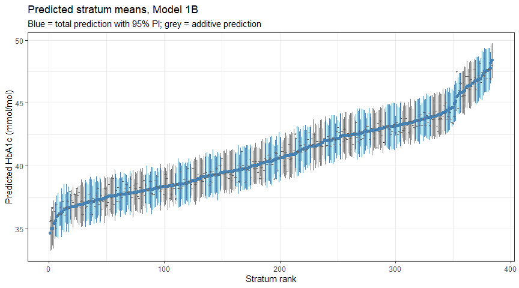
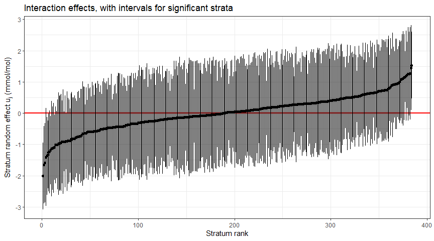
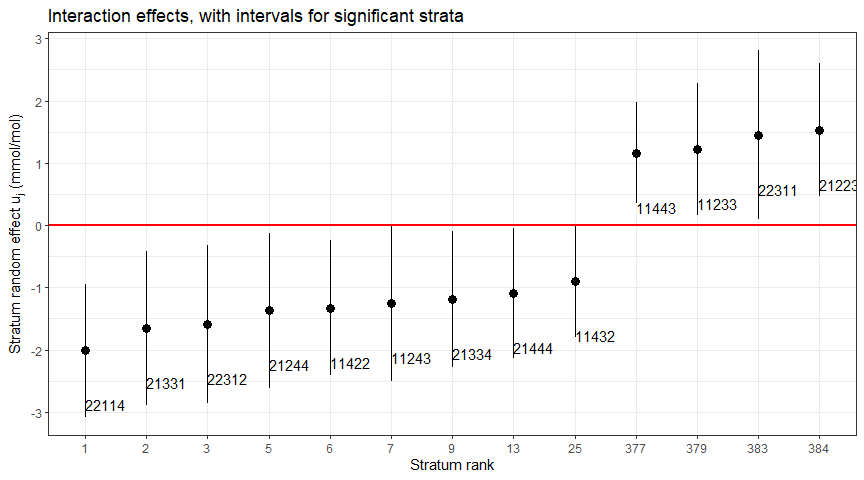
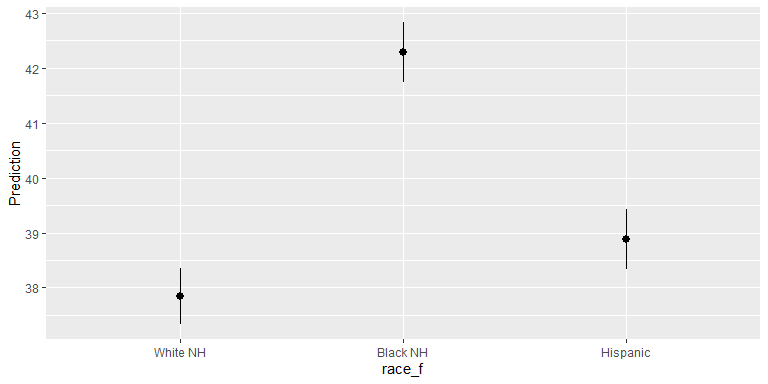
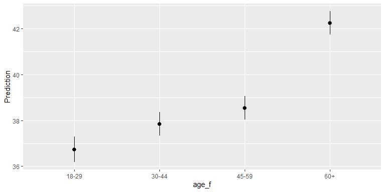
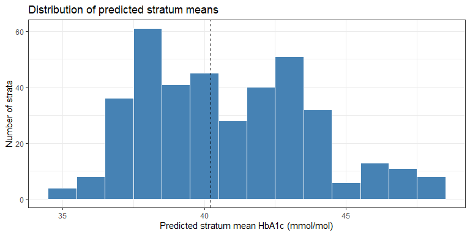

# Intersectional Multilevel Analysis of Individual Heterogeneity and Discriminatory Accuracy (MAIHDA)
Mauricio Garnier-Villarreal
2026-10-21

- [<span class="toc-section-number">1</span> Introduction to
  Intersectional MAIHDA](#introduction-to-intersectional-maihda)
  - [<span class="toc-section-number">1.1</span> Why intersectionality
    needs its own method](#why-intersectionality-needs-its-own-method)
  - [<span class="toc-section-number">1.2</span> What MAIHDA does
    instead](#what-maihda-does-instead)
  - [<span class="toc-section-number">1.3</span> The three goals of a
    quantitative intersectional
    analysis](#the-three-goals-of-a-quantitative-intersectional-analysis)
- [<span class="toc-section-number">2</span> The MAIHDA
  Model](#the-maihda-model)
  - [<span class="toc-section-number">2.1</span> Notation](#notation)
  - [<span class="toc-section-number">2.2</span> Model 1A: the null
    (empty) model](#model-1a-the-null-empty-model)
  - [<span class="toc-section-number">2.3</span> Model 1B: the additive
    main effects model](#model-1b-the-additive-main-effects-model)
  - [<span class="toc-section-number">2.4</span> The Variance Partition
    Coefficient (VPC)](#the-variance-partition-coefficient-vpc)
  - [<span class="toc-section-number">2.5</span> The Proportional Change
    in Variance (PCV)](#the-proportional-change-in-variance-pcv)
  - [<span class="toc-section-number">2.6</span> Stratum-level
    quantities](#stratum-level-quantities)
  - [<span class="toc-section-number">2.7</span> A caution on
    interpreting a low VPC](#a-caution-on-interpreting-a-low-vpc)
- [<span class="toc-section-number">3</span> Packages and
  Data](#packages-and-data)
- [<span class="toc-section-number">4</span> Constructing the Stratum
  Identifier](#constructing-the-stratum-identifier)
- [<span class="toc-section-number">5</span> Describing the
  Data](#describing-the-data)
  - [<span class="toc-section-number">5.1</span> Stratum
    sizes](#stratum-sizes)
- [<span class="toc-section-number">6</span> Model 1A: The Null
  Model](#model-1a-the-null-model)
  - [<span class="toc-section-number">6.1</span> Reading the
    output](#reading-the-output)
- [<span class="toc-section-number">7</span> Model 1B: The Additive Main
  Effects Model](#model-1b-the-additive-main-effects-model-1)
  - [<span class="toc-section-number">7.1</span> Reading the fixed
    effects](#reading-the-fixed-effects)
  - [<span class="toc-section-number">7.2</span> Variance components and
    the PCV](#variance-components-and-the-pcv)
  - [<span class="toc-section-number">7.3</span> What this pattern
    means](#what-this-pattern-means)
- [<span class="toc-section-number">8</span> Stratum-Level
  Predictions](#stratum-level-predictions)
  - [<span class="toc-section-number">8.1</span> Reading the
    decomposition](#reading-the-decomposition)
- [<span class="toc-section-number">9</span> Interval Estimates with
  merTools](#interval-estimates-with-mertools)
  - [<span class="toc-section-number">9.1</span> Why we need a second
    method](#why-we-need-a-second-method)
  - [<span class="toc-section-number">9.2</span> Prediction intervals
    for the stratum means](#prediction-intervals-for-the-stratum-means)
  - [<span class="toc-section-number">9.3</span> Cross-checking the
    point estimates with
    marginaleffects](#cross-checking-the-point-estimates-with-marginaleffects)
  - [<span class="toc-section-number">9.4</span> Prediction intervals
    for a new individual](#prediction-intervals-for-a-new-individual)
  - [<span class="toc-section-number">9.5</span> Ranking the
    strata](#ranking-the-strata)
  - [<span class="toc-section-number">9.6</span> Caterpillar plot of
    predicted stratum
    means](#caterpillar-plot-of-predicted-stratum-means)
  - [<span class="toc-section-number">9.7</span> Caterpillar plot of the
    stratum random
    effects](#caterpillar-plot-of-the-stratum-random-effects)
- [<span class="toc-section-number">10</span> Visualising with
  marginaleffects](#visualising-with-marginaleffects)
  - [<span class="toc-section-number">10.1</span> Marginal predictions
    for each axis](#marginal-predictions-for-each-axis)
  - [<span class="toc-section-number">10.2</span> Discriminatory
    accuracy](#discriminatory-accuracy)
- [<span class="toc-section-number">11</span> Effect
  Sizes](#effect-sizes)
  - [<span class="toc-section-number">11.1</span> VPC and PCV as the
    primary effect sizes](#vpc-and-pcv-as-the-primary-effect-sizes)
  - [<span class="toc-section-number">11.2</span> Marginal and
    conditional R² with
    performance](#marginal-and-conditional-r²-with-performance)
  - [<span class="toc-section-number">11.3</span> Rights and Sterba
    decomposition with
    r2mlm](#rights-and-sterba-decomposition-with-r2mlm)
  - [<span class="toc-section-number">11.4</span> Recommended reporting
    set](#recommended-reporting-set)
- [<span class="toc-section-number">12</span> Summary and
  Recommendations](#summary-and-recommendations)
  - [<span class="toc-section-number">12.1</span> Limitations to
    acknowledge](#limitations-to-acknowledge)
- [<span class="toc-section-number">13</span> References](#references)

## Introduction to Intersectional MAIHDA

In the previous tutorials we used multilevel models (MLM) for clustered
data: students in schools (16_MLM1), centering and contextual effects
(16_1_MLM_centering), interactions (16_2_MLM_interactions), and repeated
measures (16_3 and 16_4). This tutorial introduces a different and
increasingly influential application of the same machinery:
**intersectional Multilevel Analysis of Individual Heterogeneity and
Discriminatory Accuracy**, or **MAIHDA**.

### Why intersectionality needs its own method

Intersectionality is a theoretical framework that emerged from Black
feminist scholarship (Crenshaw, 1989; Collins, 1990). Its central claim
is that systems of oppression (sexism, racism, class exploitation) are
**interlocking and mutually constituted**, not separable. A person does
not experience “gender” and “race” as two independent exposures that add
up; they occupy a position defined by the *combination*.

Translated into quantitative terms, individuals occupy positions in
intersecting social hierarchies, and some intersectional positions
experience advantages or disadvantages that are **unique to that
particular location**, for example, forms of discrimination targeted
specifically at Black women. Others raise or lower the probability of
advantageous or disadvantageous exposures.

The methodological problem is that conventional regression handles this
poorly. To allow every combination of characteristics to have its own
predicted outcome, a single-level model needs a dummy for every stratum
**plus** all two-way, three-way, four-way and five-way interactions.
With five axes in the example below that is **384 regression
coefficients**. This produces several well-known problems:

- **Combinatorial explosion.** The number of coefficients grows
  geometrically with each added axis.
- **Reference-category dependence.** Multiply privileged strata (e.g.,
  high-income White men) end up as the reference, which has been
  critiqued for reinforcing their social primacy as the “default.”
- **Coefficient-level thinking.** Attention falls on individual
  coefficients (“is the effect of race bigger than the effect of
  income?”) rather than on the collective additive pattern, which pushes
  analysts back toward single-axis reasoning, precisely what
  intersectionality rejects.
- **Small and empty cells.** Many strata have few or no observations, so
  interaction coefficients become unstable or inestimable.

### What MAIHDA does instead

MAIHDA reframes the problem as a **multilevel** one. Each unique
combination of social positions, each **stratum**, is treated as a
**level-2 context**, and individuals are nested within strata. This
single move resolves most of the problems above:

- The fixed part of the model contains only the **additive main
  effects** (12 dummies + intercept, not 384 coefficients).
- The **deviation of each stratum from what the additive main effects
  predict** is captured by a single level-2 random effect $u_j$, one for
  *every* stratum, automatically.
- The **between-stratum variance** $\sigma^2_u$ becomes a summary
  measure of how much outcomes cluster by intersectional position.
- **Partial pooling (shrinkage)** stabilises estimates for small and
  even empty strata, borrowing strength from the additive pattern rather
  than discarding or wildly over-estimating them.

Crucially, this is not merely a computational convenience. Treating
strata as contexts expresses the theoretical claim that intersectional
positions are **social locations**, not properties of independent
individuals. And it shifts attention from a single $R^2$ to a
decomposition of individual heterogeneity into a between-stratum and a
within-stratum component, addressing the “tyranny of the averages”
critique that group means alone say nothing about how well group
membership predicts individual outcomes (Merlo, 2018).

### The three goals of a quantitative intersectional analysis

The tutorial paper organises MAIHDA results around three goals, and it
is worth keeping them separate because they answer different questions:

1.  **Stratum inequalities**: how do average outcomes differ across
    intersectional strata?
2.  **Heterogeneity and discriminatory accuracy**: how much of the total
    individual variation lies *between* strata, and how well does
    knowing someone’s stratum discriminate their outcome?
3.  **Interaction effects**: for which strata does the observed outcome
    depart from what additive patterns would predict?

A complete analysis reports all three. Reporting only the first, or only
the second, gives a misleading picture.

## The MAIHDA Model

### Notation

Let $y_{ij}$ be the outcome for individual $i$ in stratum $j$, where
$j = 1, \dots, J$ and, in our example, $J = 384$.

### Model 1A: the null (empty) model

$$y_{ij} = \beta_0 + u_j + e_{ij}$$

$$u_j \sim N(0, \sigma^2_u), \qquad e_{ij} \sim N(0, \sigma^2_e)$$

- $\beta_0$ is the **precision-weighted grand mean** — an average of
  stratum means, weighted by the precision (inverse variance) of each
  stratum mean. It is *not* the same as the sample mean, because small
  strata are down-weighted.
- $\sigma^2_u$ is the **between-stratum variance**: how much stratum
  means vary around $\beta_0$.
- $\sigma^2_e$ is the **within-stratum, between-individual variance**.
- $u_j$ is the stratum random effect: how far stratum $j$’s mean sits
  from the grand mean, after reliability adjustment.

Model 1A contains no explanatory variables. It is the “empty” model and
it answers goal 2 alone: how much of the total individual variation in
the outcome is located between intersectional strata?

### Model 1B: the additive main effects model

$$y_{ij} = \beta_0 + \beta_1 x_{1j} + \cdots + \beta_p x_{pj} + u_j + e_{ij}$$

where $x_{1j}, \dots, x_{pj}$ are the dummy variables coding the axes
that define the strata (here sex, race/ethnicity, education, income, age
— 12 dummies, 13 coefficients including the intercept). **No interaction
terms are entered as fixed effects.** Instead:

- $\beta_0 + \beta_1 x_{1j} + \cdots + \beta_p x_{pj}$ is the **additive
  prediction** for stratum $j$ — what we would expect if the axes
  combined purely additively.
- $u_j$ now captures the **deviation from that additive prediction**. It
  *is* the interaction effect for stratum $j$, estimated for every
  stratum at once.
- $\sigma^2_u$ now measures the between-stratum variance **that remains
  after adjustment for the additive main effects** — that is, the
  variance attributable to interactions.

This is the key conceptual shift: in Model 1B, $\sigma^2_u$ is no longer
“all between-stratum variance,” it is “between-stratum variance **not
explained by additive effects**.”

### The Variance Partition Coefficient (VPC)

$$\text{VPC} = \frac{\sigma^2_u}{\sigma^2_u + \sigma^2_e}$$

The proportion of total individual variance that lies between strata. It
is the direct analogue of the ICC from 16_MLM1, and the interpretive
conventions carry over: values below about 0.05 indicate negligible
clustering, values above about 0.10 indicate substantial clustering. For
comparison, most multilevel studies of individuals nested in
neighbourhoods or schools report VPCs below 5%.

The VPC is also a measure of **discriminatory accuracy**: if VPC = 100%,
knowing a person’s stratum tells you their outcome exactly; if VPC = 0%,
stratum membership tells you nothing. It is the linear-model counterpart
of the AUC in the logistic case.

### The Proportional Change in Variance (PCV)

$$\text{PCV} = \frac{\sigma^2_{u,\text{Model 1A}} - \sigma^2_{u,\text{Model 1B}}}{\sigma^2_{u,\text{Model 1A}}}$$

The proportion of between-stratum variance explained by the additive
main effects. Its complement, $1 - \text{PCV}$, is the proportion
**attributable to interaction effects**. If PCV is meaningfully below
100%, interactions are needed to characterise the inequities.

### Stratum-level quantities

For each stratum we compute three things:

| Quantity | Definition | Meaning |
|----|----|----|
| Total predicted value | $\hat\beta_0 + \sum \hat\beta_p x_{pj} + \hat u_j$ | The model’s best estimate of the stratum mean |
| Additive predicted value | $\hat\beta_0 + \sum \hat\beta_p x_{pj}$ | What additive effects alone imply |
| Interaction effect | total − additive $= \hat u_j$ | The stratum-specific departure from additivity |

### A caution on interpreting a low VPC

A low VPC does **not** mean low inequity. In a MAIHDA study of
birthweight, typical VPCs were only 2.9% (singletons) and 3.1% (twins),
yet the difference in predicted mean birthweight between the highest-
and lowest-scoring strata was 388 g and 435 g respectively, clinically
meaningful. Individual-level variance in birthweight is large, which
mechanically depresses the VPC even when between-stratum differences are
substantial. Always report the VPC **alongside** the range of predicted
stratum values.

## Packages and Data

We use the simulated dataset distributed with the tutorial paper
(`TutorialData.dta`). It contains 33,000 individuals nested in 384
intersectional strata defined by five axes.

``` r
library(lme4)
library(lmerTest)
library(rio)
library(parameters)
library(marginaleffects)
library(merTools)        
library(ggplot2)
library(performance)
library(r2mlm)
library(summarytools)
```

``` r
tut <- import("TutorialData.dta", setclass = "data.frame")

str(tut)
```

    'data.frame':   33000 obs. of  7 variables:
     $ HbA1c    : num  42.6 42.3 44.7 38.4 32.9 ...
      ..- attr(*, "label")= chr "HbA1c (mmol/mol)"
      ..- attr(*, "format.stata")= chr "%9.1f"
     $ diabetic : num  0 0 0 0 0 0 0 0 1 0 ...
      ..- attr(*, "format.stata")= chr "%9.0g"
     $ sex      : num  2 2 1 1 1 1 2 1 1 2 ...
      ..- attr(*, "format.stata")= chr "%12.0g"
      ..- attr(*, "labels")= Named num [1:2] 1 2
      .. ..- attr(*, "names")= chr [1:2] "Male" "Female"
     $ race     : num  1 3 1 1 1 3 1 3 2 2 ...
      ..- attr(*, "format.stata")= chr "%12.0g"
      ..- attr(*, "labels")= Named num [1:3] 1 2 3
      .. ..- attr(*, "names")= chr [1:3] "White" "Black" "Hispanic"
     $ education: num  1 2 3 2 3 4 1 3 3 4 ...
      ..- attr(*, "format.stata")= chr "%21.0g"
      ..- attr(*, "labels")= Named num [1:4] 1 2 3 4
      .. ..- attr(*, "names")= chr [1:4] "Less than high school" "High school" "Some college" "College plus"
     $ income   : num  1 1 4 2 4 3 2 2 3 3 ...
      ..- attr(*, "format.stata")= chr "%12.0g"
      ..- attr(*, "labels")= Named num [1:4] 1 2 3 4
      .. ..- attr(*, "names")= chr [1:4] "Low" "Low-mid" "Mid-high" "High"
     $ age      : num  4 3 4 4 3 2 4 1 2 3 ...
      ..- attr(*, "format.stata")= chr "%12.0g"
      ..- attr(*, "labels")= Named num [1:4] 1 2 3 4
      .. ..- attr(*, "names")= chr [1:4] "18-29" "30-44" "45-59" "60+"

``` r
dim(tut)
```

    [1] 33000     7

The variables are:

| Variable | Description |
|----|----|
| `HbA1c` | Glycated haemoglobin, mmol/mol (continuous outcome) |
| `diabetic` | Binary indicator, HbA1c ≥ 48 mmol/mol (used in the logistic models, not here) |
| `sex` | 1 = Male, 2 = Female |
| `race` | 1 = White non-Hispanic, 2 = Black non-Hispanic, 3 = Hispanic/Latino |
| `education` | 1 = Less than high school, 2 = High school, 3 = Some college, 4 = College degree or more |
| `income` | 1 = Low (\<100% poverty), 2 = Low-middle, 3 = High-middle, 4 = High (≥400%) |
| `age` | 1 = 18–29, 2 = 30–44, 3 = 45–59, 4 = 60+ |

## Constructing the Stratum Identifier

The stratum identifier is a five-digit code where each digit position
corresponds to one axis. This is the approach used in the paper, and it
has the advantage that you can read the stratum composition directly off
the code.

``` r
# Build a five-digit stratum ID: sex, race, education, income, age
tut$stratum <- 10000 * tut$sex +
               1000 * tut$race +
                100 * tut$education +
                 10 * tut$income +
                      tut$age

# One digit per axis, so 384 possible combinations
length(unique(tut$stratum))
```

    [1] 384

``` r
tut$stratum <- factor(tut$stratum)

# Sort by stratum for readability
tut <- tut[order(tut$stratum), ]

# How many individuals per stratum?
head(table(tut$stratum))
```


    11111 11112 11113 11114 11121 11122 
       41    55    55   120    30    61 

We also create **labelled factor versions** of the five axes. This
matters: the axis codes are numeric, so entering them as
`sex + race + ...` would fit a single linear term per axis and produce 6
coefficients, not the 13 reported in the paper’s Table 3.

``` r
tut$sex_f  <- factor(tut$sex, levels = 1:2,
                     labels = c("Male", "Female"))
tut$race_f <- factor(tut$race, levels = 1:3,
                     labels = c("White NH", "Black NH", "Hispanic"))
tut$educ_f <- factor(tut$education, levels = 1:4,
                     labels = c("< High school", "High school",
                                "Some college", "College+"))
tut$inc_f  <- factor(tut$income, levels = 1:4,
                     labels = c("Low", "Low-middle",
                                "High-middle", "High"))
tut$age_f  <- factor(tut$age, levels = 1:4,
                     labels = c("18-29", "30-44", "45-59", "60+"))
```

Record each stratum’s size. `ave()` computes a group-wise statistic and
returns a vector aligned with the rows of the data, which is what we
need in base R.

``` r
tut$strataN <- ave(tut$HbA1c, tut$stratum, FUN = function(x) length(x))

summary(tut$strataN)
```

       Min. 1st Qu.  Median    Mean 3rd Qu.    Max. 
        1.0    79.0   139.0   205.5   277.0   683.0 

## Describing the Data

Before modelling, it is worth distinguishing three quantities that are
easy to conflate:

- **Sample mean** — the mean of all 33,000 individual scores. Makes no
  reference to strata.
- **Grand mean** — the mean of the 384 *observed* stratum means. Treats
  each stratum equally regardless of size.
- **Precision-weighted grand mean (PWGM)** — the intercept of Model 1A.
  A weighted average of stratum means, weighted by precision, so small
  strata count less.

``` r
descr(tut$HbA1c)
```

    Descriptive Statistics  
    tut$HbA1c  
    N: 33000  

                           HbA1c
    ----------------- ----------
                 Mean      40.22
              Std.Dev       9.94
                  Min      10.30
                   Q1      34.03
               Median      39.76
                   Q3      44.99
                  Max     101.17
                  MAD       8.10
                  IQR      10.96
                   CV       0.25
             Skewness       0.90
          SE.Skewness       0.01
             Kurtosis       2.40
              N.Valid   33000.00
                    N   33000.00
            Pct.Valid     100.00

We collapse to the stratum level once and keep this object (`strat`) for
the descriptives. It is **not** overwritten later; the prediction-level
dataset is called `strat_pred`.

``` r
strat <- aggregate(tut[, c("HbA1c", "strataN")],
                   by = tut[, c("stratum", "sex_f", "race_f",
                                "educ_f", "inc_f", "age_f")],
                   FUN = mean)

dim(strat)
```

    [1] 384   8

``` r
head(strat)
```

      stratum  sex_f   race_f        educ_f inc_f age_f    HbA1c strataN
    1   11111   Male White NH < High school   Low 18-29 36.71571      41
    2   21111 Female White NH < High school   Low 18-29 36.28354      63
    3   12111   Male Black NH < High school   Low 18-29 44.89314      40
    4   22111 Female Black NH < High school   Low 18-29 41.01230      54
    5   13111   Male Hispanic < High school   Low 18-29 41.13758      80
    6   23111 Female Hispanic < High school   Low 18-29 38.66742     118

``` r
descr(strat$HbA1c)
```

    Descriptive Statistics  
    strat$HbA1c  
    N: 384  

                         HbA1c
    ----------------- --------
                 Mean    40.80
              Std.Dev     3.92
                  Min    23.47
                   Q1    38.23
               Median    40.35
                   Q3    43.32
                  Max    53.80
                  MAD     3.76
                  IQR     5.09
                   CV     0.10
             Skewness    -0.09
          SE.Skewness     0.12
             Kurtosis     1.63
              N.Valid   384.00
                    N   384.00
            Pct.Valid   100.00

The sample mean is about 40.2 mmol/mol and the grand mean about 40.8
mmol/mol. They differ because the grand mean weights a stratum of 5
people the same as a stratum of 500.

### Stratum sizes

MAIHDA is more tolerant of small strata than single-level interaction
models, but you should still report the distribution of stratum sizes,
because shrinkage is strongest where strata are smallest.

``` r
descr(strat$strataN)
```

    Descriptive Statistics  
    strat$aN  
    N: 384  

                            aN
    ----------------- --------
                 Mean    85.94
              Std.Dev   101.50
                  Min     1.00
                   Q1    26.00
               Median    55.00
                   Q3   111.00
                  Max   683.00
                  MAD    53.37
                  IQR    85.00
                   CV     1.18
             Skewness     2.83
          SE.Skewness     0.12
             Kurtosis    10.25
              N.Valid   384.00
                    N   384.00
            Pct.Valid   100.00

``` r
cbind(
  threshold = c(100, 50, 30, 20, 10),
  n_strata  = sapply(c(100, 50, 30, 20, 10),
                     function(k) sum(strat$strataN >= k)),
  pct       = round(100 * sapply(c(100, 50, 30, 20, 10),
                     function(k) mean(strat$strataN >= k)), 1)
)
```

         threshold n_strata  pct
    [1,]       100      107 27.9
    [2,]        50      202 52.6
    [3,]        30      267 69.5
    [4,]        20      311 81.0
    [5,]        10      347 90.4

In these data about 81% of strata have 20 or more individuals and 70%
have 30 or more, so most strata are reasonably well estimated. The
remaining small strata are handled by shrinkage rather than discarded —
but their estimates will be pulled toward the additive prediction, which
is precisely why very small strata rarely show “significant” interaction
effects.

## Model 1A: The Null Model

``` r
m1A <- lmer(HbA1c ~ 1 + (1 | stratum),
            data = tut, REML = TRUE)

parameters(m1A, ci_method = "profile")
```

    # Fixed Effects

    Parameter   | Coefficient |   SE |         95% CI | t(32997) |      p
    ---------------------------------------------------------------------
    (Intercept) |       40.79 | 0.18 | [40.44, 41.14] |   231.31 | < .001

    # Random Effects

    Parameter               | Coefficient
    -------------------------------------
    SD (Intercept: stratum) |        3.06
    SD (Residual)           |        9.50

``` r
VarCorr(m1A)
```

     Groups   Name        Std.Dev.
     stratum  (Intercept) 3.0604  
     Residual             9.5007  

### Reading the output

``` r
vc1A <- as.data.frame(VarCorr(m1A))
vc1A
```

           grp        var1 var2      vcov    sdcor
    1  stratum (Intercept) <NA>  9.366157 3.060418
    2 Residual        <NA> <NA> 90.263536 9.500712

VPC is equivalent to the ICC

``` r
icc(m1A)
```

    # Intraclass Correlation Coefficient

        Adjusted ICC: 0.094
      Unadjusted ICC: 0.094

- **Intercept ($\beta_0 = 40.79$)**: the precision-weighted grand mean
  of HbA1c. This is an average of stratum means, not of individuals.
- **Between-stratum variance ($\sigma^2_u = 9.33$)**: stratum means vary
  around the grand mean with a standard deviation of
  $\sqrt{9.33} = 3.05$ mmol/mol.
- **Within-stratum variance ($\sigma^2_e = 90.26$)**: individuals vary
  around their own stratum mean with a standard deviation of 9.50
  mmol/mol.
- **VPC = 0.094**: about **9.4% of the total individual variation in
  HbA1c lies between intersectional strata**.

That VPC is large by the standards of most multilevel applications,
where 5% is typical and 10% is rarely exceeded. Substantively, it says
that intersectional position is strongly associated with HbA1c, but it
also says that about 90% of the variation is *within* strata, so knowing
someone’s stratum is a long way from knowing their HbA1c. Both halves of
that sentence matter, and reporting only the first would be the “tyranny
of the averages” in action.

## Model 1B: The Additive Main Effects Model

``` r
m1B <- lmer(HbA1c ~ sex_f + race_f + educ_f + inc_f + age_f + (1 | stratum),
            data = tut, REML = TRUE)

parameters(m1B, ci_method = "profile")
```

    # Fixed Effects

    Parameter             | Coefficient |   SE |         95% CI | t(32985) |      p
    -------------------------------------------------------------------------------
    (Intercept)           |       38.03 | 0.30 | [37.45, 38.62] |   125.11 | < .001
    sex f [Female]        |       -0.52 | 0.16 | [-0.83, -0.21] |    -3.20 | 0.001 
    race f [Black NH]     |        4.45 | 0.20 | [ 4.07,  4.82] |    22.82 | < .001
    race f [Hispanic]     |        1.04 | 0.20 | [ 0.66,  1.42] |     5.23 | < .001
    educ f [High school]  |       -0.55 | 0.24 | [-1.01, -0.07] |    -2.26 | 0.024 
    educ f [Some college] |       -0.54 | 0.25 | [-1.03, -0.06] |    -2.16 | 0.031 
    educ f [College+]     |       -1.13 | 0.25 | [-1.61, -0.65] |    -4.55 | < .001
    inc f [Low-middle]    |        0.18 | 0.22 | [-0.24,  0.60] |     0.83 | 0.408 
    inc f [High-middle]   |       -0.30 | 0.22 | [-0.73,  0.13] |    -1.34 | 0.179 
    inc f [High]          |       -1.32 | 0.26 | [-1.82, -0.83] |    -5.14 | < .001
    age f [30-44]         |        1.11 | 0.24 | [ 0.65,  1.56] |     4.69 | < .001
    age f [45-59]         |        1.81 | 0.24 | [ 1.35,  2.27] |     7.52 | < .001
    age f [60+]           |        5.51 | 0.25 | [ 5.03,  5.98] |    22.44 | < .001

    # Random Effects

    Parameter               | Coefficient
    -------------------------------------
    SD (Intercept: stratum) |        0.94
    SD (Residual)           |        9.50

### Reading the fixed effects

The published estimates for this model are reproduced below; your output
should match them closely:

| Axis | Category | Estimate | 95% CI |
|----|----|----|----|
| Intercept | Male, White NH, \< HS, Low income, 18–29 | 38.03 | \[37.45, 38.62\] |
| Sex | Female | −0.52 | \[−0.83, −0.21\] |
| Race | Black NH | +4.45 | \[4.08, 4.82\] |
| Race | Hispanic/Latino | +1.04 | \[0.66, 1.42\] |
| Education | High school | −0.54 | \[−1.01, −0.07\] |
| Education | Some college | −0.55 | \[−1.03, −0.06\] |
| Education | College+ | −1.13 | \[−1.61, −0.65\] |
| Income | Low-middle | −0.18 | \[−0.60, 0.23\] |
| Income | High-middle | −0.30 | \[−0.73, 0.12\] |
| Income | High | −1.33 | \[−1.82, −0.83\] |
| Age | 30–44 | +1.10 | \[0.65, 1.56\] |
| Age | 45–59 | +1.81 | \[1.35, 2.27\] |
| Age | 60+ | +5.50 | \[5.03, 5.98\] |

Two interpretive points:

- **The intercept is now reference-category specific.** 38.03 is the
  predicted HbA1c for the reference stratum (male, White non-Hispanic,
  less than high school, low income, aged 18–29). It is *not* the grand
  mean. This is exactly the reference-category dependence that critiques
  of conventional approaches highlight, and exactly why MAIHDA results
  should be read from the predicted stratum values, not from the
  intercept.
- **These coefficients are additive averages, not stratum effects.**
  “Black NH = +4.45” means that, *on average across all strata
  containing Black individuals*, HbA1c is 4.45 mmol/mol higher than
  comparable White strata. It says nothing about any particular
  intersectional position. The interesting intersectional findings live
  in $u_j$ and in the predicted values.

### Variance components and the PCV

``` r
vc1B <- as.data.frame(VarCorr(m1B))
vc1B
```

           grp        var1 var2       vcov     sdcor
    1  stratum (Intercept) <NA>  0.8843758 0.9404126
    2 Residual        <NA> <NA> 90.2660277 9.5008435

``` r
v_u_1A <- vc1A$vcov[vc1A$grp != "Residual"]
v_u_1B <- vc1B$vcov[vc1B$grp != "Residual"]

# VPC in the additive model
icc(m1B)
```

    # Intraclass Correlation Coefficient

        Adjusted ICC: 0.010
      Unadjusted ICC: 0.009

``` r
# PCV: proportion of between-stratum variance explained by additive effects
pcv <- (v_u_1A - v_u_1B) / v_u_1A
pcv
```

    [1] 0.9055775

``` r
# Complement: share attributable to interaction effects
1 - pcv
```

    [1] 0.09442248

The results are dramatic:

| Quantity                              | Model 1A | Model 1B  |
|---------------------------------------|----------|-----------|
| Between-stratum variance $\sigma^2_u$ | 9.33     | 0.80      |
| Within-stratum variance $\sigma^2_e$  | 90.26    | 90.27     |
| **VPC**                               | **9.4%** | **0.9%**  |
| **PCV**                               | —        | **90.6%** |

- **The between-stratum variance collapses** from 9.33 to 0.80 — a 91.4%
  reduction.
- **The VPC falls from 9.4% to 0.9%**, meaning that after adjustment for
  additive main effects, less than 1% of individual variation remains
  between strata.
- **The within-stratum variance is essentially unchanged** (90.26 →
  90.27). This is the crucial diagnostic: the additive main effects
  reshuffle *where* the between-stratum variance went, but they do not
  reduce individual-level heterogeneity at all.

### What this pattern means

The combination of a high PCV and a low residual VPC is the most common
MAIHDA finding, and it has a specific interpretation: **the inequities
in these data are largely additive**. Most of the between-stratum
variance is captured by consistent, additive patterns across the five
axes, and only about 9.4% of the between-stratum variance (the
complement of the PCV, $1 - PCV$) is attributable to interaction
effects.

But this does **not** mean “there is no intersectionality,” for three
reasons the tutorial paper is careful to spell out:

1.  **The VPC and PCV are summary measures across all 384 strata.** If
    383 strata are well described by additive effects and one has a
    large interaction, that interaction will be diluted in the summary
    statistics. Look for standout strata in the predicted values and
    random effects, not only in the aggregate.
2.  **Shrinkage is conservative by design.** MAIHDA protects against
    Type I error by pulling small-stratum estimates toward the additive
    prediction. Genuine but small interactions in small strata may
    therefore be invisible in the sample.
3.  **“No interaction” does not disprove intersectionality.** Additive
    patterns can themselves be produced by intersecting systems of
    oppression. MAIHDA is one tool within an intersectional analysis,
    not a test of the theory.

## Stratum-Level Predictions

The heart of a MAIHDA analysis is the decomposition of each stratum’s
predicted value into an additive part and an interaction part.

``` r
# Total predicted value: fixed effects + stratum random effect
tut$pred_total <- predict(m1B, re.form = NULL)

# Additive predicted value: fixed effects only
tut$pred_add <- predict(m1B, re.form = NA)

# Interaction effect: the stratum random effect u_j
tut$pred_int <- tut$pred_total - tut$pred_add
```

Collapse to the stratum level. Note this is a **new object**,
`strat_pred`, distinct from the descriptive `strat` created earlier:

``` r
strat_pred <- aggregate(tut[, c("HbA1c", "pred_total", "pred_add", "pred_int")],
                        by = tut[, c("stratum", "sex_f", "race_f",
                                     "educ_f", "inc_f", "age_f")],
                        FUN = mean)

dim(strat_pred)
```

    [1] 384  10

``` r
head(strat_pred)
```

      stratum  sex_f   race_f        educ_f inc_f age_f    HbA1c pred_total
    1   11111   Male White NH < High school   Low 18-29 36.71571   37.65588
    2   21111 Female White NH < High school   Low 18-29 36.28354   37.04691
    3   12111   Male Black NH < High school   Low 18-29 44.89314   43.16230
    4   22111 Female Black NH < High school   Low 18-29 41.01230   41.63768
    5   13111   Male Hispanic < High school   Low 18-29 41.13758   39.97846
    6   23111 Female Hispanic < High school   Low 18-29 38.66742   38.61505
      pred_add    pred_int
    1 38.03354 -0.37766190
    2 37.51809 -0.47118027
    3 42.48399  0.67831311
    4 41.96854 -0.33086227
    5 39.06995  0.90850997
    6 38.55450  0.06054773

### Reading the decomposition

For each stratum:

- `pred_add` is a **deterministic function of the five axes**. Because
  there are only 13 fixed parameters, many strata share the same
  additive prediction, all strata with the same combination of
  categories have identical `pred_add`.
- `pred_int` is $u_j$, the departure from additivity. It is what makes
  each stratum’s predicted value unique.
- `pred_total` is what the model actually predicts for that stratum.

``` r
# Range of additive vs total predictions
range(strat_pred$pred_add)
```

    [1] 35.06135 48.17414

``` r
range(strat_pred$pred_total)
```

    [1] 34.68935 48.40067

``` r
# Largest positive and negative interaction effects
strat_pred[which.max(strat_pred$pred_int),
           c("stratum", "pred_add", "pred_int", "pred_total")]
```

        stratum pred_add pred_int pred_total
    224   21223 38.95839  1.55169   40.51008

``` r
strat_pred[which.min(strat_pred$pred_int),
           c("stratum", "pred_add", "pred_int", "pred_total")]
```

        stratum pred_add  pred_int pred_total
    292   22114 47.47974 -1.996214   45.48352

The strata with the largest absolute $u_j$ are the candidates for
“standout” intersectional effects. Because of shrinkage, a stratum with
a large $u_j$ is one where the data were strong enough to overcome the
pull toward the additive prediction, which is exactly the protection
against false positives that MAIHDA is designed to provide.

## Interval Estimates with merTools

### Why we need a second method

`marginaleffects` gives the right **point estimates**, but for `lmer`
models it propagates only the uncertainty in the fixed effects. For a
prediction

$$\hat{y}_j = \mathbf{x}_j'\hat{\boldsymbol\beta} + \hat{u}_j$$

the variance has up to three components:

$$\text{Var}(\hat{y}_j) = \underbrace{\text{Var}(\mathbf{x}_j'\hat{\boldsymbol\beta})}_{\text{fixed effects}} + \underbrace{\text{Var}(\hat{u}_j - u_j)}_{\text{random effect}} + \underbrace{\sigma^2_e}_{\text{residual}}$$

| Function | Includes | Interval describes |
|----|----|----|
| `marginaleffects::predictions(re.form = NA)` | fixed effects only | The **population-average** prediction, averaging over strata |
| `marginaleffects::predictions(re.form = NULL)` | fixed effects only (CIs); point estimate includes $\hat{u}_j$ | The stratum mean, **treating $\hat{u}_j$ as known** |
| `predictInterval(include.resid.var = FALSE)` | fixed effects **+** random effect | The **stratum mean**, accounting for the fact that $\hat{u}_j$ is itself estimated |
| `predictInterval(include.resid.var = TRUE)` | all three | A **new individual’s** outcome in that stratum |

The practical consequence is that **`marginaleffects` intervals are too
narrow for MAIHDA’s stratum-level questions**. The stratum random effect
$\hat{u}_j$ is a *prediction*, not a known quantity, and its uncertainty
is largest exactly where strata are small — which is precisely where
shrinkage matters most. Using fixed-effect-only intervals therefore
overstates confidence in the strata we know least about, and it will
flag more strata as “significantly different from additive” than is
warranted.

The paper’s Figure 3B, which highlights strata whose 95% CI for $u_j$
excludes zero, relies on the wider, simulation-based intervals. We use
`merTools` for those.

### Prediction intervals for the stratum means

``` r
# One row per stratum: the model has only level-2 predictors,
# so the predicted value is constant within a stratum
nd_strat <- strat_pred[, c("stratum", "sex_f", "race_f",
                           "educ_f", "inc_f", "age_f")]

# Align factor levels with the model frame (defensive but important)
nd_strat$stratum <- factor(nd_strat$stratum, levels = levels(tut$stratum))
nd_strat$sex_f   <- factor(nd_strat$sex_f,   levels = levels(tut$sex_f))
nd_strat$race_f  <- factor(nd_strat$race_f,  levels = levels(tut$race_f))
nd_strat$educ_f  <- factor(nd_strat$educ_f,  levels = levels(tut$educ_f))
nd_strat$inc_f   <- factor(nd_strat$inc_f,   levels = levels(tut$inc_f))
nd_strat$age_f   <- factor(nd_strat$age_f,   levels = levels(tut$age_f))

dim(nd_strat)
```

    [1] 384   6

``` r
set.seed(354612)   # reproducibility of the simulation

# Prediction intervals for the STRATUM MEAN
# (include.resid.var = FALSE: fixed + random uncertainty, no residual)
pi_mean <- predictInterval(m1B,
                           newdata           = nd_strat,
                           level             = 0.95,
                           n.sims            = 1000,
                           stat              = "median",
                           include.resid.var = FALSE)

strat_pred$pi_fit <- pi_mean$fit
strat_pred$pi_lwr <- pi_mean$lwr
strat_pred$pi_upr <- pi_mean$upr

head(strat_pred[, c("stratum", "pred_total", "pi_fit", "pi_lwr", "pi_upr")], 5)
```

      stratum pred_total   pi_fit   pi_lwr   pi_upr
    1   11111   37.65588 37.65996 36.07197 39.33105
    2   21111   37.04691 37.07754 35.47852 38.57186
    3   12111   43.16230 43.16429 41.51611 44.80234
    4   22111   41.63768 41.64065 40.09661 43.20519
    5   13111   39.97846 39.94280 38.48216 41.45901

Note that `pi_fit` and `pred_total` are very close (both estimate the
stratum mean) but `pi_lwr`/`pi_upr` are **wider** than the intervals
`marginaleffects` reports.

### Cross-checking the point estimates with marginaleffects

Because the point estimates should agree exactly, this is a useful check
that both packages are describing the same quantity:

``` r
pred_me <- predictions(m1B, newdata = nd_strat, re.form = NULL)

# Should be ~0: same point estimates, different interval logic
max(abs(pred_me$estimate - strat_pred$pi_fit))
```

    [1] 0.1049436

### Prediction intervals for a new individual

If instead you want to describe the range of HbA1c values you would
expect for a *new person* in that stratum, set
`include.resid.var = TRUE`. This adds the within-stratum residual
variance and produces a much wider interval.

``` r
pi_indiv <- predictInterval(m1B,
                            newdata           = nd_strat,
                            level             = 0.95,
                            n.sims            = 1000,
                            include.resid.var = TRUE)

descr(pi_indiv$upr - pi_indiv$lwr)   # compare with the stratum-mean intervals
```

    Descriptive Statistics  
    pi_indiv$upr - pi_indiv$lwr  
    N: 384  

                        upr - pi_indiv$lwr
    ----------------- --------------------
                 Mean                37.25
              Std.Dev                 1.07
                  Min                34.54
                   Q1                36.53
               Median                37.17
                   Q3                37.96
                  Max                41.33
                  MAD                 1.05
                  IQR                 1.42
                   CV                 0.03
             Skewness                 0.31
          SE.Skewness                 0.12
             Kurtosis                 0.24
              N.Valid               384.00
                    N               384.00
            Pct.Valid               100.00

The two intervals differ by roughly $\pm 1.96\,\sigma_e$, which here is
about $\pm 18.6$ mmol/mol — an enormous difference. Always label which
interval you are showing.

### Ranking the strata

Ranking happens **after** `pi_fit` is attached, so the plot axis and the
plotted values are consistent:

``` r
strat_pred <- strat_pred[order(strat_pred$pi_fit), ]
strat_pred$rank <- seq_len(nrow(strat_pred))

head(strat_pred[, c("stratum", "pi_fit", "pi_lwr", "pi_upr", "pred_int", "rank")], 5)
```

       stratum   pi_fit   pi_lwr   pi_upr   pred_int rank
    91   11441 34.69047 33.25410 35.99482 -0.8874494    1
    86   21341 34.99874 33.35674 36.71347 -0.6853207    2
    62   21331 35.05842 33.66984 36.36751 -1.6524790    3
    80   21241 35.42615 33.44206 37.24895 -0.2531125    4
    20   21411 35.63715 34.21207 37.04509 -0.7602647    5

``` r
tail(strat_pred[, c("stratum", "pi_fit", "pi_lwr", "pi_upr", "pred_int", "rank")], 5)
```

        stratum   pi_fit   pi_lwr   pi_upr    pred_int rank
    327   12324 47.61983 45.88423 49.36910 -0.01842440  380
    339   12134 47.71151 46.02996 49.35855 -0.03165606  381
    298   22214 47.78495 46.54357 49.04287  0.86137745  382
    316   22124 48.21278 46.78428 49.62752  0.50965790  383
    291   12114 48.42840 46.99837 49.75841  0.40548319  384

### Caterpillar plot of predicted stratum means

``` r
ggplot(strat_pred, aes(x = rank, y = pi_fit)) +
  geom_pointrange(aes(ymin = pi_lwr, ymax = pi_upr),
                  size = 0.25, colour = "steelblue") +
  geom_point(aes(y = pred_add), colour = "grey40", size = 0.8) +
  labs(x = "Stratum rank",
       y = "Predicted HbA1c (mmol/mol)",
       title = "Predicted stratum means, Model 1B",
       subtitle = "Blue = total prediction with 95% PI; grey = additive prediction") +
  theme_bw()
```

<div id="fig-caterpillar-means">



Figure 1

</div>

Read this for three things:

1.  **The overall spread** of predicted values — how far apart the most
    and least advantaged strata are.
2.  **The vertical gap between blue and grey** at each rank — the size
    of the interaction effect $u_j$.
3.  **The width of the intervals** — the widest belong to the smallest
    strata, which is the visual signature of precision weighting at
    work.

### Caterpillar plot of the stratum random effects

The random effect $u_j$ *is* the interaction effect, so plotting it
directly is often the clearest way to see where additivity breaks down.
`REsim()` returns simulation-based intervals for the random effects
themselves.

``` r
set.seed(354612)

re_sim <- REsim(m1B, n.sims = 1000)

re_sim$lo  <- re_sim$median - 1.96 * re_sim$sd
re_sim$hi  <- re_sim$median + 1.96 * re_sim$sd
re_sim$sig <- re_sim$lo > 0 | re_sim$hi < 0

re_sim <- re_sim[order(re_sim$median), ]
re_sim$rank <- seq_len(nrow(re_sim))

head(re_sim)
```

        groupFctr groupID        term      mean    median        sd        lo
    260   stratum   22114 (Intercept) -2.011396 -2.011287 0.5443178 -3.078150
    233   stratum   21331 (Intercept) -1.645376 -1.654219 0.6287598 -2.886588
    290   stratum   22312 (Intercept) -1.597666 -1.594346 0.6469190 -2.862308
    203   stratum   21133 (Intercept) -1.427307 -1.407490 0.7987353 -2.973011
    224   stratum   21244 (Intercept) -1.379928 -1.369551 0.6363436 -2.616785
    54    stratum   11422 (Intercept) -1.325147 -1.325716 0.5528100 -2.409223
                hi   sig rank
    260 -0.9444239  TRUE    1
    233 -0.4218496  TRUE    2
    290 -0.3263853  TRUE    3
    203  0.1580309 FALSE    4
    224 -0.1223178  TRUE    5
    54  -0.2422080  TRUE    6

``` r
ggplot(re_sim, aes(x = rank, y = median)) +
  geom_hline(yintercept = 0, colour = "red", linewidth = 0.8) +
  geom_point(aes(colour = sig), size = 1.2) +
  geom_pointrange(data = re_sim,
                  aes(ymin = lo, ymax = hi), size = 0.3) +
  scale_colour_manual(values = c("grey60", "steelblue"), guide = "none") +
  labs(x = "Stratum rank",
       y = expression(paste("Stratum random effect ", u[j], " (mmol/mol)")),
       title = "Interaction effects, with intervals for significant strata") +
  theme_bw()
```

<div id="fig-caterpillar-re">



Figure 2

</div>

Then we can plot only the ones with a “significant” deviation

``` r
re_sim_sig <- subset(re_sim, sig == TRUE)
re_sim_sig$rank <- as.factor(re_sim_sig$rank)


ggplot(re_sim_sig, aes(x=rank, y=median, label=groupID)) +
  geom_point(size=3) +
  geom_pointrange(aes(ymin=lo, ymax=hi)) + 
  geom_hline(yintercept=0, color="red", linewidth=1) +
  geom_text(hjust=0, vjust=5) +
  labs(x = "Stratum rank",
       y = expression(paste("Stratum random effect ", u[j], " (mmol/mol)")),
       title = "Interaction effects, with intervals for significant strata") +
  theme_bw()
```

<div id="fig-caterpillar-re-sig">



Figure 3

</div>

Because `REsim()` propagates the uncertainty in $\hat{u}_j$, far fewer
strata are flagged than a fixed-effect-only interval would suggest. That
conservatism is a feature of the method, not a defect: MAIHDA is
designed to protect against Type I error, and the intervals should
reflect that.

> **A note on `merTools` speed.** `predictInterval()` and `REsim()` run
> 1,000 simulations by default. With 384 strata this takes a few
> seconds; with 33,000 individual rows it is noticeably slower. That is
> why we build a one-row-per-stratum grid (`nd_strat`) rather than
> predicting for the full dataset — the model contains only level-2
> predictors, so the stratum mean is constant within stratum and no
> information is lost. The chunks above are set to `eval: false` so the
> document renders quickly; remove that flag to run them.

## Visualising with marginaleffects

`marginaleffects` remains the right tool for **axis-level** marginal
predictions and for the interaction plots used throughout this course.

### Marginal predictions for each axis

``` r
plot_predictions(m1B, condition = "race_f")
```

<div id="fig-plot-race">



Figure 4

</div>

``` r
plot_predictions(m1B, condition = "age_f")
```

<div id="fig-plot-age">



Figure 5

</div>

These show the additive story: Black non-Hispanic strata average about
4.5 mmol/mol higher than White strata, and the 60+ strata about 5.5
mmol/mol higher than the 18–29 strata. Remember that these are
**averages across strata**, and that the reference levels of the other
axes determine the vertical position.

### Discriminatory accuracy

A histogram of predicted stratum values makes clear how much (or how
little) of the individual distribution the strata actually cover.

``` r
ggplot(strat_pred, aes(x = pi_fit)) +
  geom_histogram(binwidth = 1, colour = "white", fill = "steelblue") +
  geom_vline(xintercept = mean(tut$HbA1c), linetype = "dashed") +
  labs(x = "Predicted stratum mean HbA1c (mmol/mol)",
       y = "Number of strata",
       title = "Distribution of predicted stratum means") +
  theme_bw()
```

<div id="fig-hist-strata">



Figure 6

</div>

Compare the spread of this distribution with the spread of the
individual-level outcome. The predicted stratum means occupy a narrow
band relative to the full individual range — which is exactly what a VPC
of 0.9% looks like.

## Effect Sizes

### VPC and PCV as the primary effect sizes

In MAIHDA the headline effect sizes are the **VPC** and the **PCV**, not
$R^2$. They answer the questions the method was built to answer: how
much heterogeneity is between strata, and how much of that is additive.

``` r
c(VPC_1A = icc(m1A)$ICC_unadjusted,
  VPC_1B = icc(m1B)$ICC_unadjusted)
```

         VPC_1A      VPC_1B 
    0.094009695 0.008926363 

``` r
c(PCV = (v_u_1A - v_u_1B) / v_u_1A)
```

          PCV 
    0.9055775 

### Marginal and conditional R² with performance

``` r
r2(m1A)
```

    # R2 for Mixed Models

      Conditional R2: 0.094
         Marginal R2: 0.000

``` r
r2(m1B)
```

    # R2 for Mixed Models

      Conditional R2: 0.089
         Marginal R2: 0.080

- **In Model 1A**, there are no fixed predictors, so the marginal $R^2$
  is 0 and the **conditional $R^2$ equals the VPC**. This is a useful
  check: `performance::r2()` and the manual VPC calculation should agree
  to rounding. In our data both give about 0.094.
- **In Model 1B**, the marginal $R^2$ is the share of total variance
  explained by the additive main effects, and the conditional $R^2$ adds
  the residual between-stratum variance. The gap between them is the
  between-stratum component not captured by the additive pattern.

One caveat: $R^2$ and the VPC answer different questions and should not
be substituted for one another. A model can have a modest marginal $R^2$
while showing a substantively large VPC, because $R^2$ is anchored to
total individual variance whereas the VPC isolates the between-stratum
share of it.

### Rights and Sterba decomposition with r2mlm

In a MAIHDA model, the `r2mlm` decomposition maps neatly onto the
substantive quantities:

| `r2mlm` component | MAIHDA meaning |
|----|----|
| $f_2$ | Variance explained by the **additive main effects** (all predictors are level-2) |
| $m$ | **Between-stratum variance remaining** after the additive effects — the interaction variance |
| $\sigma^2$ | Within-stratum, between-individual variance |
| $f_1$, $v$ | Zero here: no level-1 predictors, no random slopes |

``` r
r2mlm(m1B, bargraph = FALSE)
```

`r2mlm` only works when all predictors are continuous, so it doesnt work
on this example. You can make it work by replacing all categorical
preditors for dummy numerical variables

Two practical warnings:

1.  **`r2mlm()` needs at least one predictor.** Model 1A has none, so
    `r2mlm(m1A)` will error. Use the VPC (equivalently, the conditional
    $R^2$) for the null model instead.
2.  **`r2mlm()` can be slow or unstable with 384 level-2 units and 12
    dummy predictors.** If it fails, compute the decomposition by hand
    from the variance components, which is straightforward here because
    there are no level-1 predictors.

``` r
# Manual decomposition (equivalent to r2mlm when there are no level-1 predictors)
tot_1A <- v_u_1A + vc1A$vcov[vc1A$grp == "Residual"]
v_e_1B <- vc1B$vcov[vc1B$grp == "Residual"]

c(f2_fixed_level2 = (v_u_1A - v_u_1B) / tot_1A,
  m_between_left  = v_u_1B / tot_1A,
  sigma2_within   = v_e_1B / tot_1A)
```

    f2_fixed_level2  m_between_left   sigma2_within 
        0.085133066     0.008876629     0.906015318 

The three components sum to 1.00, and the interpretation is the one that
matters for MAIHDA: roughly 91% of the total variance is explained by
the additive main effects, under 1% remains as between-stratum
interaction variance, and about 90% is within-stratum individual
variation.

### Recommended reporting set

Following the paper and the effect-size guidance from 16_MLM1, report at
minimum:

1.  $\sigma^2_u$ and $\sigma^2_e$ for both models, with the VPC for
    each.
2.  The PCV, and its complement (the share of between-stratum variance
    attributable to interactions).
3.  The full set of additive fixed effects with confidence intervals.
4.  The range of predicted stratum values, plus the highest- and
    lowest-ranked strata with their additive and interaction components.
5.  A caterpillar plot of predicted stratum means **with
    `predictInterval()` intervals**, and a plot of $u_j$ **with
    `REsim()` intervals**.
6.  A statement about stratum sizes and the consequent degree of
    shrinkage.

Two reporting cautions specific to the intervals:

- **Do not report fixed-effect-only intervals for stratum-level
  quantities.** `marginaleffects` intervals for `lmer` models exclude
  the uncertainty in $\hat{u}_j$, so they are too narrow for exactly the
  comparisons MAIHDA is designed to make. Point estimates from
  `marginaleffects` are fine; intervals should come from
  `predictInterval()` or `REsim()`.
- **Be explicit about which interval you are showing.** An interval for
  the *stratum mean* and an interval for a *new individual in that
  stratum* differ by roughly $\pm 1.96\,\sigma_e$, which here is about
  $\pm 18.6$ mmol/mol.

## Summary and Recommendations

MAIHDA is the multilevel model from 16_MLM1 applied to a new definition
of “cluster”: the intersectional stratum. Everything you already know
about random effects, variance partitioning, and shrinkage carries over.
What changes is the interpretation.

Key points to remember:

1.  **Strata are contexts, not individual properties.** Treating each
    intersectional position as a level-2 unit is what makes the method
    both statistically tractable and theoretically faithful to
    intersectionality.

2.  **Two models, two questions.** Model 1A (null) answers “how much
    heterogeneity lies between strata?” Model 1B (additive) answers “how
    much of that is additive, and how much is interaction?”

3.  **The VPC is the headline effect size.** It is the proportion of
    individual variation between strata, and it doubles as a measure of
    discriminatory accuracy. Report it with the range of predicted
    stratum values, never alone.

4.  **The PCV tells you whether interactions matter.** A high PCV (low
    residual VPC) means inequities are largely additive; the complement
    of the PCV is the share attributable to interactions.

5.  **A low VPC does not mean low inequity.** Large within-stratum
    variance depresses the VPC even when between-stratum differences are
    substantively important. The birthweight example (VPC ≈ 3%, stratum
    difference ≈ 388 g) makes this concrete.

6.  **$u_j$ is the interaction effect.** Every stratum gets one,
    automatically, with no need to specify 384 product terms. That is
    the central computational advantage over single-level interaction
    models.

7.  **Shrinkage is a feature and a limitation.** Precision weighting
    protects small strata from wild estimates and guards against false
    positives, but it also means genuine small-stratum interactions may
    not be detected.

8.  **Use factors, not numeric axis codes.** The axis variables are
    numerically coded, so `sex + race + education + income + age` fits
    one linear term per axis (6 coefficients). Use `factor()` to get the
    12 dummies and 13 coefficients that the additive model requires.

9.  **Read the additive coefficients as averages, not stratum effects.**
    The intercept is reference-category specific, and each coefficient
    is an average across strata. The intersectional findings are in the
    predicted values and in $u_j$.

10. **Use the right tool for the right uncertainty.** `marginaleffects`
    for point estimates and axis-level plots;
    `merTools::predictInterval()` and `REsim()` for stratum-level
    intervals, because only these account for the uncertainty in
    $\hat{u}_j$.

11. **Report the whole picture.** Stratum inequalities,
    heterogeneity/discriminatory accuracy, and interaction effects are
    three separate goals. Reporting only one is an incomplete
    intersectional analysis.

### Limitations to acknowledge

- **Estimation.** These models use maximum likelihood. MCMC is slower
  but delivers credible intervals for all derived quantities (including
  stratum predictions that combine fixed and random uncertainty) without
  additional assumptions.
- **Model specification.** All MAIHDA models here are two-level
  random-intercept models. Random slopes and cross-classified structures
  are possible extensions but change the interpretation of the VPC.
- **Ongoing debate.** MAIHDA has been criticised for the interpretation
  of its variance components and stratum effects, and the field has
  responded with conceptual clarifications. Cite that debate rather than
  treating the VPC as a self-evident measure of discrimination.
- **It is a method, not the theory.** MAIHDA operationalises some
  intersectional questions well and others poorly. It does not replace
  the theoretical work of specifying which axes matter and why.

## References

- Bell, A., Holman, D., & Jones, K. (2019). Using shrinkage in
  multilevel models to understand intersectionality: A simulation study
  and a guide for best practice. *Methodology, 15*(2), 88–96.
- Collins, P. H. (1990). *Black feminist thought: Knowledge,
  consciousness, and the politics of empowerment*. Routledge.
- Crenshaw, K. (1989). Demarginalizing the intersection of race and sex:
  A Black feminist critique of antidiscrimination doctrine, feminist
  theory and antiracist politics. *University of Chicago Legal Forum*,
  139–167.
- Evans, C. R., Leckie, G., Subramanian, S. V., Bell, A., & Merlo, J.
  (2024). A tutorial for conducting intersectional multilevel analysis
  of individual heterogeneity and discriminatory accuracy (MAIHDA).
  *SSM - Population Health, 26*, 101664.
  https://doi.org/10.1016/j.ssmph.2024.101664
- Evans, C. R., Williams, D. R., Onnela, J.-P., & Subramanian, S. V.
  (2018). A multilevel approach to modeling health inequalities at the
  intersection of multiple social identities. *Social Science &
  Medicine, 203*, 64–73.
- Knowles, J. E., & Frederick, C. (2019). *merTools: Tools for analyzing
  mixed effect regression models* (R package).
- Merlo, J. (2018). Multilevel analysis of individual heterogeneity and
  discriminatory accuracy (MAIHDA) within an intersectional framework.
  *Social Science & Medicine, 203*, 74–80.
- Raudenbush, S. W., & Bryk, A. S. (2002). *Hierarchical linear models:
  Applications and data analysis methods* (2nd ed.). Sage.
- Rights, J. D., & Sterba, S. K. (2019). Quantifying explained variance
  in multilevel models: An integrative framework for defining R-squared
  measures. *Psychological Methods, 24*(3), 309–338.
